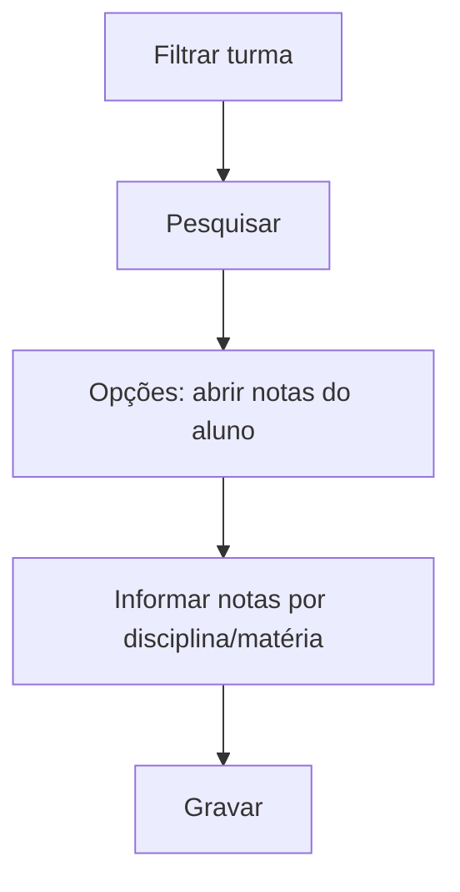

# Notas por Aluno

## Objetivo

Lançar ou ajustar as notas de **um aluno específico**, em todas as suas disciplinas/matérias e
avaliações. É usada para correções pontuais, alunos que entraram depois, turmas auxiliares ou
situações individuais.

---

## Quem pode utilizar

Professores, Coordenação, Secretaria e Administrador.

---

## Como acessar

```
Notas
→ Notas por Aluno
```

---

## Quando utilizar

- Para ajustar a nota de um aluno específico.
- Para lançar notas de alunos em **turma auxiliar** ou **turma secundária**.

---

## Como utilizar

1. Abra **Notas por Aluno**.
2. Use **Filtrar Turma** e **Selecione a Turma** para localizar o aluno.
3. Clique em **Pesquisar**.
4. Use **Opções** para abrir as notas do aluno.
5. Para cada **Disciplina**/**Matéria**, informe a **Nota** e o **Tipo/Descrição** da avaliação,
   e marque **Fez Avaliação?** quando aplicável.
6. Clique em **Gravar**.

---

## Campos e colunas

| Campo/Coluna | Descrição |
|--------------|-----------|
| Filtrar Turma / Selecione a Turma | Turma do aluno |
| Ordem / Matrícula / Nome | Identificação do aluno |
| Situação | Situação do aluno |
| Disciplina / Matéria | Disciplina e matéria avaliadas |
| Tipo / Descrição | Tipo/etapa da avaliação |
| Nota / Conceitos | Nota ou conceito |
| Turma Auxiliar / Turma Secundária | Vínculos adicionais do aluno |
| Fez Avaliação? | Indica se realizou a avaliação |

---

## Botões

| Botão | O que faz |
|-------|-----------|
| **Pesquisar** | Lista os alunos da turma |
| **Opções** | Abre as notas do aluno |
| **Gravar** | Salva as notas do aluno |
| **Cancelar** | Fecha sem salvar |

---

## Recurso: "Fez avaliação — IGNORAR para todos?"

Permite marcar de uma vez que a avaliação deve ser **ignorada** para todas as disciplinas do
aluno, útil quando o aluno não realizou determinada etapa.

---

## Resultados

- As notas do aluno são atualizadas e passam a compor o boletim.

---

## Regras importantes

- **A nota máxima permitida é 10,00.**
- Disciplinas com matérias exigem a seleção da matéria.

---

## Mensagens do sistema

- *"Nota máxima permitida é 10.00"*
- *"Informe a Matéria"*
- *"Erro ao salvar o registro"*

---

## Fluxo da funcionalidade



---

## Exemplos práticos

**Exemplo:** um aluno transferido chegou no meio do bimestre — abrir suas notas e lançar
individualmente as avaliações já realizadas.

---

## Dicas

- Use esta tela para casos individuais; para a turma toda, [Notas por Turma](notas-por-turma.md) é mais rápida.

---

## FAQ

**Consigo lançar nota de turma auxiliar aqui?**
Sim, a tela contempla **Turma Auxiliar** e **Turma Secundária** do aluno.

---

## Prints

- [ ] Lista de alunos da turma.
- [ ] Notas do aluno por disciplina.

---

## Histórico

| Data | Alteração |
|------|-----------|
| 30/07/2026 | Página criada. |
