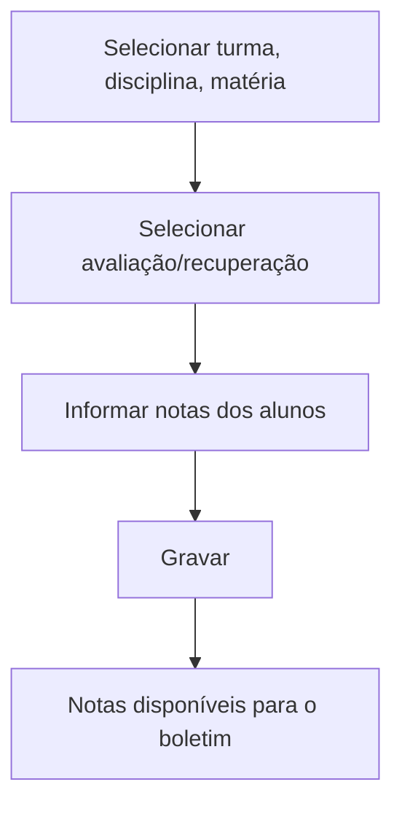

# Notas por Turma

## Objetivo

Lançar as **notas de todos os alunos de uma turma** de uma só vez, para uma **disciplina**
(e **matéria**, quando houver) e uma **avaliação/recuperação** específica. É a forma mais rápida
de registrar as notas de um bimestre/etapa.

---

## Como acessar

```
Notas
→ Notas por Turma
```

---

## Quando utilizar

- Ao fechar as notas de uma avaliação para a turma.

---

## Como utilizar

1. Abra **Notas por Turma**.
2. No painel **Seleção**, escolha a **Turma**, a **Disciplina**, a **Matéria** (se a disciplina
   tiver matérias) e a **Avaliação / Recuperação**. A lista de alunos aparece automaticamente.
3. Digite a **Nota** de cada aluno. Use **Enter** ou **↓** para ir ao próximo aluno e **↑** para voltar.
   Aceita vírgula ou ponto (7,5 ou 7.5).
4. Quando o aluno não fez a avaliação, escolha **Não** em **Fez avaliação?** — a nota passa a 0.
5. Os alunos alterados ficam marcados à esquerda; o rodapé mostra quantos ainda não foram gravados.
6. Clique em **Gravar notas**.

Para lançar a mesma avaliação em outra disciplina, basta trocar a disciplina: a avaliação
continua selecionada.

---

## Campos e colunas

| Campo/Coluna | Descrição |
|--------------|-----------|
| Turma | Turma (somente turmas com alunos matriculados) |
| Disciplina | Disciplinas ofertadas para a turma |
| Matéria | Aparece só quando a disciplina tem matérias; obrigatória nesse caso |
| Avaliação / Recuperação | Etapa avaliativa que será lançada |
| Buscar aluno | Filtra a lista por nome, matrícula ou nº de ordem |
| Nº / Aluno | Nº de ordem, nome e matrícula |
| Nota | Nota da avaliação (0 a 10, até 2 casas decimais) |
| Fez avaliação? | Sim, Não, Sem lançamento ou Ignorar |
| Conceito | Conceito do aluno (quando a turma lança por conceito, no lugar de Nota) |

No cabeçalho da seleção aparecem a forma de lançamento da turma (**nota** ou **conceito**) e,
para matérias, o **tipo de cálculo** da disciplina (Soma ou Média).

---

## Botões

| Botão | O que faz |
|-------|-----------|
| **Gravar notas** | Salva somente os alunos alterados |
| **Descartar** | Desfaz as alterações ainda não gravadas e recarrega as notas |

---

## Resultados

- As notas ficam registradas para a avaliação selecionada e compõem o boletim.

---

## Regras importantes

- Só aparecem alunos com situação **Matriculado**.
- **A nota máxima permitida é 10,00**; notas negativas ou com letras não são aceitas.
- Digitar uma nota marca **Fez avaliação? = Sim**. Apagar a nota volta para **Sem lançamento**.
- **Não** grava a nota 0. **Sem lançamento** deixa a nota em branco. **Ignorar** mantém a nota como está.
- Ao trocar turma, disciplina, matéria ou avaliação com alterações não gravadas, o sistema pede
  confirmação antes de descartá-las.
- Gravar marca a turma como pendente de processamento do boletim.

---

## Mensagens do sistema

- *"A nota máxima é 10."* / *"A nota não pode ser negativa."* / *"Use apenas números, por exemplo 7,5."*
  (aparecem embaixo do campo de nota)
- *"Corrija as notas destacadas em vermelho antes de gravar."*
- *"X de N alunos não foram gravados (…)"* — no lançamento por conceito, os demais foram gravados;
  os que falharam continuam marcados para nova tentativa.

---

## Fluxo da funcionalidade



---

## Exemplos práticos

**Exemplo:** turma "7º Ano A", disciplina "Geografia", avaliação "1º Bimestre": digitar a nota de
cada aluno e gravar.

---

## Dicas

- Confira a **avaliação/recuperação** selecionada antes de digitar, para não lançar na etapa errada.

---

## Erros comuns

- **Campo de nota em vermelho** → corrija o valor (0 a 10) antes de gravar.
- **A lista não aparece** → verifique se a matéria foi selecionada (disciplinas com matérias).

---

## FAQ

**Preciso lançar por aluno também?**
Não. Aqui você lança a turma toda; para ajustes pontuais use [Notas por Aluno](notas-por-aluno.md).

---

## Prints

- [ ] Seleção de turma/disciplina/avaliação.
- [ ] Grade de notas da turma.

---

## Histórico

| Data | Alteração |
|------|-----------|
| 30/07/2026 | Página criada. |
| 02/11/2026 | Novo layout: seleção em painel, busca de aluno, navegação por teclado, gravação só dos alterados e regra de "Fez avaliação?". |
