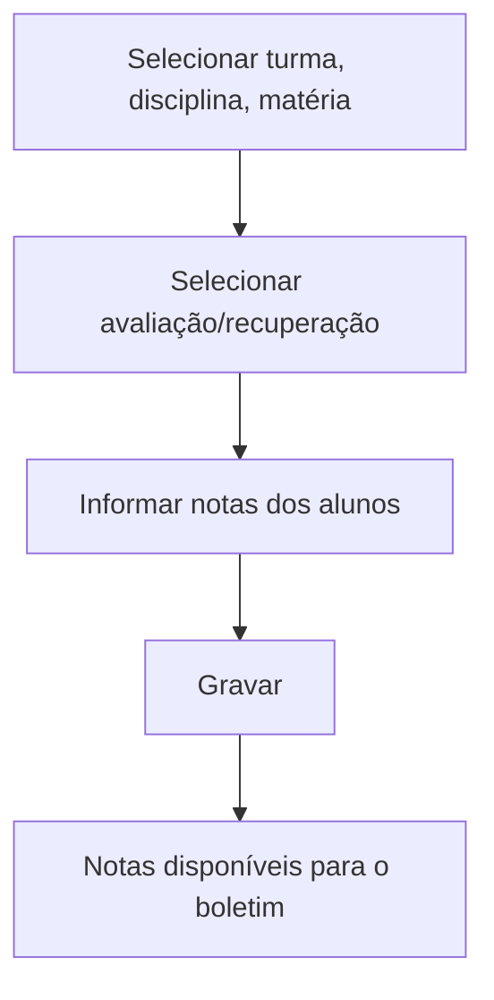

# Notas por Turma

## Objetivo

Lançar as **notas de todos os alunos de uma turma** de uma só vez, para uma **disciplina**
(e **matéria**, quando houver) e uma **avaliação/recuperação** específica. É a forma mais rápida
de registrar as notas de um bimestre/etapa.

---

## Quem pode utilizar

Professores da disciplina, Coordenação, Secretaria e Administrador.

---

## Como acessar

```
Notas
→ Notas por Turma
```

---

## Quando utilizar

- Ao fechar as notas de uma avaliação para a turma.

---

## Como utilizar

1. Abra **Notas por Turma**.
2. Selecione a **Turma**, a **Disciplina** e a **Matéria** (se houver).
3. Selecione a **Avaliação/Recuperação** (o período/etapa).
4. A lista de alunos aparece com a coluna de **Nota**.
5. Informe a **Nota** de cada aluno e, quando aplicável, marque **Fez Avaliação?**.
6. Clique em **Gravar**.

---

## Campos e colunas

| Campo/Coluna | Descrição |
|--------------|-----------|
| Selecione a Turma | Turma |
| Selecione a Disciplina | Disciplina |
| Selecione a Matéria | Matéria (quando a disciplina tem matérias) |
| Selecione a Avaliação/Recuperação | Etapa avaliativa |
| Nº de Ordem / Matrícula / Nome | Identificação do aluno |
| Nota | Nota lançada (máx. 10,00) |
| Conceitos | Conceito (quando a turma usa conceito) |
| Fez Avaliação? | Indica se o aluno realizou a avaliação |

---

## Botões

| Botão | O que faz |
|-------|-----------|
| **Gravar** | Salva as notas da turma |

---

## Resultados

- As notas ficam registradas para a avaliação selecionada e compõem o boletim.

---

## Regras importantes

- **Turma**, **Disciplina** e **Avaliação** são obrigatórias; matéria é obrigatória se a
  disciplina tiver matérias.
- **A nota máxima permitida é 10,00.**
- Disciplinas com **matérias** exigem a seleção da matéria.

---

## Mensagens do sistema

- *"Selecione Turma!"* / *"Selecione Disciplina!"* / *"Selecione Materia!"* / *"Selecione Avaliação!"*
- *"Informe a Matéria"*
- *"Nota máxima permitida é 10.00"*
- *"Erro ao salvar o registro"*

---

## Fluxo da funcionalidade



---

## Exemplos práticos

**Exemplo:** turma "7º Ano A", disciplina "Geografia", avaliação "1º Bimestre": digitar a nota de
cada aluno e gravar.

---

## Dicas

- Confira a **avaliação/recuperação** selecionada antes de digitar, para não lançar na etapa errada.

---

## Erros comuns

- **"Nota máxima permitida é 10.00"** → revise a nota digitada.
- **"Informe a Matéria"** → selecione a matéria da disciplina.

---

## FAQ

**Preciso lançar por aluno também?**
Não. Aqui você lança a turma toda; para ajustes pontuais use [Notas por Aluno](notas-por-aluno.md).

---

## Prints

- [ ] Seleção de turma/disciplina/avaliação.
- [ ] Grade de notas da turma.

---

## Histórico

| Data | Alteração |
|------|-----------|
| 30/07/2026 | Página criada. |
