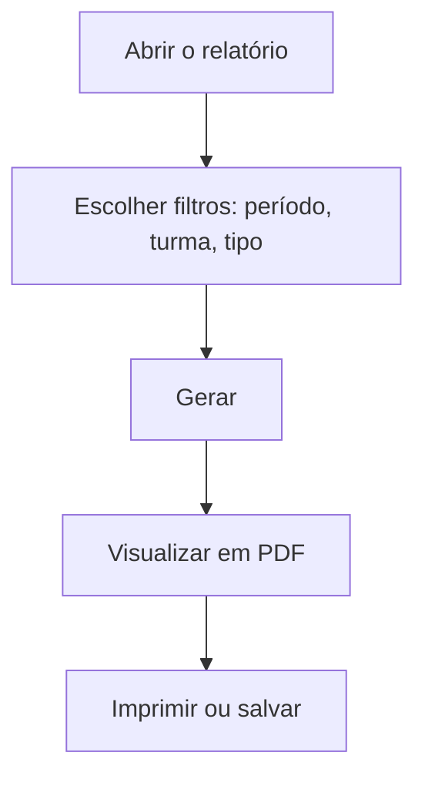

# Módulo Relatórios

## Objetivo

O módulo **Relatórios** reúne os **documentos e listagens** que a escola emite a partir dos dados
do sistema: relatórios **financeiros** (diário, contas a pagar), de **secretaria** (alunos,
matrícula, frequência, boletim) e de **funcionários**, além da listagem de **turmas**. Em geral,
cada relatório funciona no mesmo padrão: você escolhe **filtros**, gera e **imprime/exporta** (PDF).

## Como acessar

As telas ficam no grupo **Relatórios** do menu lateral.

## Mapa do módulo

| Relatório | Para que serve | Documentação |
|-----------|----------------|--------------|
| Relatórios Financeiros | Diário Financeiro e Contas a Pagar | [Abrir](financeiros.md) |
| Relatórios de Secretaria | Alunos por Turma, Assinaturas, Matrícula, Frequência, Boletim | [Abrir](secretaria.md) |
| Relatórios de Funcionários | Relação de Colaboradores: Resumido, Detalhado e Assinatura | [Abrir](funcionarios.md) |
| Relatório de Turma Regular | Listagem de turmas | [Abrir](turma-regular.md) |

## Como os relatórios funcionam

> Os relatórios refletem os dados **já lançados/processados**. Se um número parecer errado,
> verifique se o lançamento e (no caso do boletim) o **processamento** foram feitos.

---

## Histórico

| Data | Alteração |
|------|-----------|
| 30/07/2026 | Página criada. |
