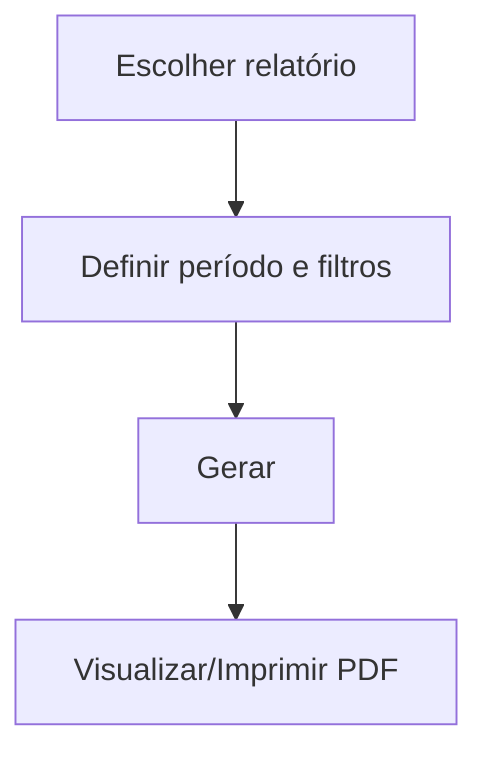

# Relatórios Financeiros

## Objetivo

Emitir os principais relatórios do financeiro: o **Diário Financeiro** (movimentação de caixa por
período) e o **Contas a Pagar** (despesas a vencer, vencidas e pagas). Servem para conferência,
prestação de contas e gestão do fluxo de caixa.

---

## Como acessar

```
Relatórios
→ Financeiro
→ Consulta Diário  (ou)  Contas a Pagar
```

---

## Quando utilizar

- Para conferir a movimentação de caixa de um período (Diário).
- Para acompanhar despesas a vencer/vencidas/pagas (Contas a Pagar).

---

## Como utilizar

### Diário Financeiro (Consulta Diário)

1. Abra **Relatórios → Financeiro → Consulta Diário**.
2. Informe **Data inicial** e **Data final** e os filtros desejados (fonte, forma de pagamento,
   direção de entrada/saída, complementos).
3. Gere o relatório e visualize/imprima.

### Contas a Pagar

1. Abra **Relatórios → Financeiro → Contas a Pagar**.
2. Filtre por **Centro de Custo**, **Conta**, **Credor**, **Fonte**, **Forma de Pagamento** e
   pela situação (**A Pagar**, **A Pagar a vencer**, **A Pagar vencidas**, pagas).
3. Escolha a base da data (**Lançamento**, **Data Pagto/Programação**) e o escopo (**Global**).
4. Gere e imprima.

---

## Filtros (principais)

| Filtro | Relatório | Descrição |
|--------|-----------|-----------|
| Data inicial / final | Ambos | Período do relatório |
| Fonte / Forma de Pagamento | Ambos | Origem/forma do valor |
| Direção (entrada/saída) | Diário | Tipo de movimentação |
| Centro de Custo / Conta / Credor | Contas a Pagar | Classificação da despesa |
| A Pagar / a vencer / vencidas | Contas a Pagar | Situação das despesas |
| Não considerar taxa de cartão | Contas a Pagar | Exclui taxas de cartão |

---

## Botões

| Botão | O que faz |
|-------|-----------|
| **Gerar/Imprimir** | Produz o relatório em PDF |
| **Exportar para Excel** (ícone verde) | Exporta os lançamentos do **Diário Financeiro** para planilha. Fica no **topo da lista**, ao lado da pesquisa |

O Diário Financeiro exibe, acima da lista, cartões com os **totais** do período: **Valor**,
**Descontos**, **Desconto Extra**, **Multas** e **Juros**.

A lista do Diário Financeiro traz a coluna **Recibo**, com o número do recibo de cada lançamento —
útil para localizar rapidamente a origem de uma movimentação e para conferir estornos.

---

## Resultados

- **Diário:** lista cronológica das movimentações do período, com totais.
- **Contas a Pagar:** relação de despesas conforme os filtros, com totais por situação.

---

## Regras importantes

- Os relatórios refletem os **lançamentos** do período — confira encerramentos e ajustes antes.
- O relatório de **Contas a Pagar** também é acessível a partir da tela [Contas a Pagar](../financeiro/contas-a-pagar.md).

---

## Fluxo da funcionalidade



---

## Exemplos práticos

**Exemplo:** emitir o Diário Financeiro do mês para conciliar o caixa; emitir o Contas a Pagar
"vencidas" para priorizar pagamentos.

---

## Dicas

- Use o filtro de **Centro de Custo** no Contas a Pagar para análises gerenciais por área.

---

## FAQ

**O diário mostra recebimentos e pagamentos?**
Sim, a movimentação do caixa no período (entradas e saídas), conforme os filtros.

---

## Prints

- [ ] Filtros do Diário Financeiro.
- [ ] Filtros do Contas a Pagar.
- [ ] Relatórios gerados.

---

## Histórico

| Data | Alteração |
|------|-----------|
| 30/07/2026 | Página criada. |
| 21/08/2026 | O **Diário Financeiro (Consulta Diário)** passou a exibir a coluna **Recibo**, com o número do recibo de cada lançamento. |
