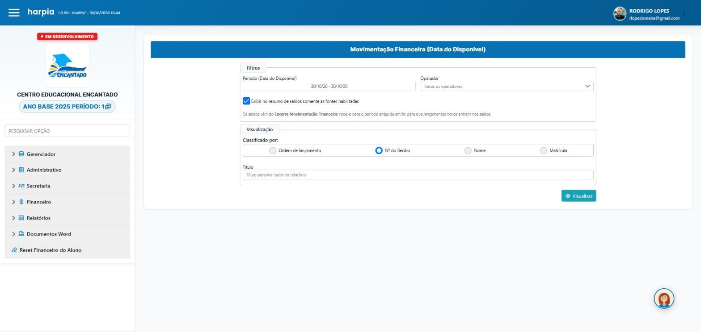
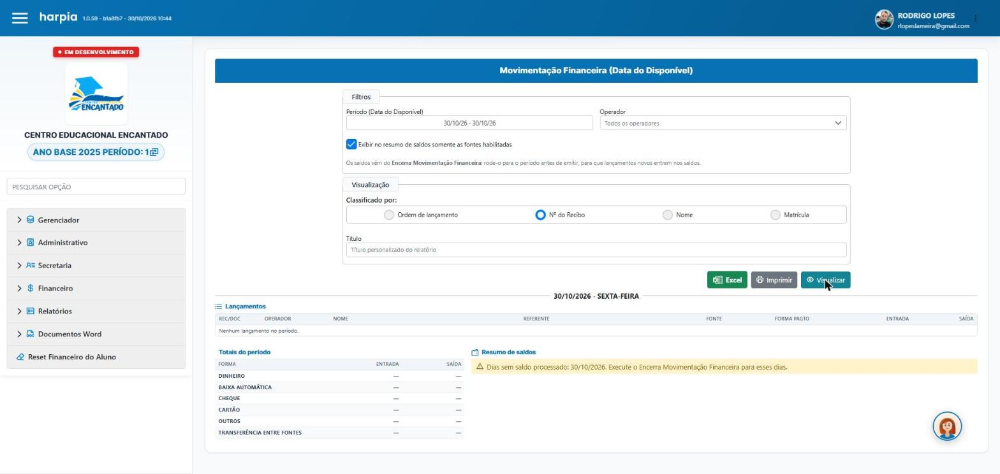
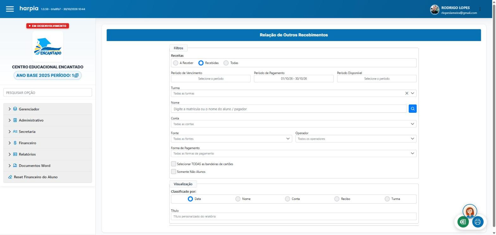
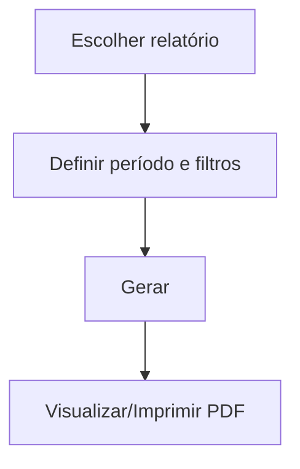

# Relatórios Financeiros

## Objetivo

Emitir os principais relatórios do financeiro: o **Diário Financeiro** (movimentação de caixa por
período), o **Contas a Pagar** (despesas a vencer, vencidas e pagas), a **Movimentação Financeira**
(entradas, saídas e saldos por fonte) e a **Relação de Outros Recebimentos** (receitas a receber e
recebidas). Servem para conferência, prestação de contas e gestão do fluxo de caixa.

---

## Como acessar

```
Relatórios
→ Financeiro
→ Consulta Diário  (ou)  Contas a Pagar  (ou)  Movimentação Financeira  (ou)  Outros Recebimentos
```

> O nome exato das duas últimas opções no menu depende da configuração da escola (rotas *Movimentação Financeira* e *Receitas Outros Recebimentos*).

---

## Quando utilizar

- Para conferir a movimentação de caixa de um período (Diário).
- Para acompanhar despesas a vencer/vencidas/pagas (Contas a Pagar).

---

## Como utilizar

### Diário Financeiro (Consulta Diário)

1. Abra **Relatórios → Financeiro → Consulta Diário**.
2. A tela abre com o período de **Dt. Lançamento** em **hoje**. Ajuste **Dt. Lançamento** e/ou **Dt. Pagamento** (cada um é um campo de período, com os botões **Limpar**, **Hoje** e **Confirmar**).
3. Se quiser, filtre por **Tarefa**, **Forma de Pagamento**, **Fonte**, **Operador** e **Nome**, e use as caixas **Lançamentos de Faturas** (só lançamentos ligados a fatura de cartão institucional) e **Exibir Taxas** (inclui as taxas de cartão, que ficam ocultas por padrão).
4. Clique em **Pesquisar** e visualize/imprima. **Limpar** zera os filtros.

*(Print sugerido: filtros do Diário com período, Tarefa e caixas Lançamentos de Faturas / Exibir Taxas.)*

### Movimentação Financeira

Mostra, por dia e por fonte, o que **entrou**, o que **saiu**, as **transferências entre fontes** e os saldos (inicial, final e ajustado).

1. Abra **Relatórios → Financeiro → Movimentação Financeira**. A tela se chama *Movimentação Financeira (Data do Disponível)* e lembra que os saldos vêm do **Encerra Movimentação Financeira**: rode-o para o período antes de emitir.
2. Informe o **Período (Data do Disponível)** — obrigatório, no máximo **366 dias**.
3. Se quiser, escolha o **Operador** (vale só para os lançamentos) e marque **Exibir no resumo de saldos somente as fontes habilitadas**.
4. Em **Visualização**, escolha **Classificado por**: *Ordem de lançamento*, *Nº do Recibo*, *Nome* ou *Matrícula*, e digite um **Título** personalizado (opcional).
5. Clique em **Visualizar**. A prévia mostra os lançamentos (colunas Rec/Doc, Operador, Nome, Referente, Fonte, Forma Pagto, Entrada e Saída), o quadro de **totais por forma** (Dinheiro, Baixa Automática, Cheque, Cartão, Outros e Transferência entre Fontes) e o **Resumo de saldos** (Sdo. Inicial, Entradas, Transf. Fonte, Saídas, Transf. Fonte, Sdo. Final e Sdo. Ajustado).
6. Use **Imprimir** (PDF) ou **Excel** (planilha com 3 abas: Lançamentos, Totais e Resumo de Saldos). Os botões aparecem depois de visualizar; mudar qualquer filtro limpa a prévia e é preciso **Visualizar** de novo.

:::warning Dias sem saldo processado
Se algum dia do período não tiver o saldo processado, o resumo de saldos é trocado pelo aviso
*"Dias sem saldo processado: dd/mm/aaaa, …"* pedindo para executar o
[Encerramento da Movimentação](../financeiro/encerramento-movimentacao.md). Sem lançamentos no período,
o sistema avisa: *"Nenhuma movimentação encontrada no período. Verifique se o Encerra Movimentação Financeira foi executado."*
:::





### Lançamentos de Entrada de Caixa

Lista as **entradas (receitas)** lançadas no Caixa e nos Bancos, para conferência. Não inclui taxas de cartão nem transferências entre fontes.

1. Abra **Relatórios → Financeiro → Lançamentos de Entrada de Caixa**.
2. Informe o **Período (Data do Lançamento)** — obrigatório, no máximo **366 dias**.
3. Se quiser, filtre por **Operador**, **Conta/Fonte** e **Forma de pagamento**. Marque **Incluir lançamentos estornados** para vê-los na lista (aparecem com "(ESTORNADO)").
4. Clique em **Visualizar**. A tela mostra os lançamentos (Data, Rec/Doc, Operador, Nome, Referente, Fonte, Forma Pagto e Valor) e, abaixo, a síntese: **filtros aplicados**, **totais por forma de pagamento**, **totais por fonte** e o **total geral** (valor, multa, juros e desconto). Mudar qualquer filtro limpa a prévia.

### Relação de Outros Recebimentos

Lista as receitas lançadas em [Outros Recebimentos](../financeiro/outros-recebimentos.md).

1. Abra **Relatórios → Financeiro → Outros Recebimentos**.
2. Em **Receitas**, escolha **A Receber**, **Recebidas** (padrão) ou **Todas**.
3. Filtre por **Período de Vencimento**, **Período de Pagamento**, **Período Disponível**, **Turma**, **Nome**, **Conta**, **Fonte**, **Operador** e **Forma de Pagamento**. As caixas **Selecionar TODAS as bandeiras de cartões** e **Somente Não Alunos** refinam o resultado.
4. Em **Visualização**, escolha **Classificado por** *Data*, *Nome*, *Conta*, *Recibo* ou *Turma* e, se quiser, um **Título**.
5. Use o ícone azul de **Imprimir** (PDF) ou o verde de **Exportar para Excel**, no canto inferior direito da tela.

Sem resultado, aparece *"Nenhum registro encontrado para os filtros selecionados."*



### Contas a Pagar

1. Abra **Relatórios → Financeiro → Contas a Pagar**.
2. Filtre por **Centro de Custo**, **Conta**, **Credor**, **Fonte**, **Forma de Pagamento** e
   pela situação (**A Pagar**, **A Pagar a vencer**, **A Pagar vencidas**, pagas).
3. Escolha a base da data (**Lançamento**, **Data Pagto/Programação**) e o escopo (**Global**).
4. Gere e imprima.

---

## Filtros (principais)

| Filtro | Relatório | Descrição |
|--------|-----------|-----------|
| Data inicial / final | Contas a Pagar | Período do relatório |
| Dt. Lançamento / Dt. Pagamento | Diário | Períodos (campo de período com Limpar/Hoje/Confirmar) |
| Operador | Diário | Lista todos os usuários da escola |
| Lançamentos de Faturas | Diário | Só lançamentos de fatura de cartão institucional |
| Exibir Taxas | Diário | Mostra também as taxas de cartão (ocultas por padrão) |
| Fonte / Forma de Pagamento | Ambos | Origem/forma do valor |
| Período (Data do Disponível) | Movimentação Financeira | Obrigatório; máximo de 366 dias |
| Tipo (A Receber / Recebidas / Todas) | Outros Recebimentos | Situação das receitas |
| Centro de Custo / Conta / Credor | Contas a Pagar | Classificação da despesa |
| A Pagar / a vencer / vencidas | Contas a Pagar | Situação das despesas |
| Não considerar taxa de cartão | Contas a Pagar | Exclui taxas de cartão |

---

## Botões

| Botão | O que faz |
|-------|-----------|
| **Gerar/Imprimir** | Produz o relatório em PDF |
| **Exportar para Excel** (ícone verde) | Exporta os lançamentos do **Diário Financeiro** para planilha. Fica no **topo da lista**, ao lado da pesquisa |

O Diário Financeiro **não exibe mais** os cartões de totais nem a linha **TOTAIS** no rodapé (retirados em setembro/2026). A lista mostra as colunas **Valor**, **Operador**, **Desconto**, **Desc. Extra**, **Multa** e **Juros** linha a linha, e passou a vir em ordem de lançamento (mais antigo primeiro), 10 linhas por página.

A coluna **Tarefa** tem cores: **RECMEN** (azul), **Out. Recebimentos** (verde-petróleo), **APAGAR** (âmbar) e **SANGRIA** (terracota). Lançamentos de fatura de cartão mostram, na **Referência**, etiquetas **Fat. #N** (verde, fatura quitada) ou **Fat. Pendente** (amarela) e o nome do cartão. Cartões RPU aparecem como *(Nx RPU)*.

A lista do Diário Financeiro traz a coluna **Recibo**, com o número do recibo de cada lançamento —
útil para localizar rapidamente a origem de uma movimentação e para conferir estornos.

---

## Resultados

- **Movimentação Financeira:** lançamentos do período com totais por forma e saldos por fonte.
- **Outros Recebimentos:** relação das receitas conforme os filtros.
- **Diário:** lista cronológica das movimentações do período, com totais.
- **Contas a Pagar:** relação de despesas conforme os filtros, com totais por situação.

---

## Regras importantes

- Os relatórios refletem os **lançamentos** do período — confira encerramentos e ajustes antes.
- O relatório de **Contas a Pagar** também é acessível a partir da tela [Contas a Pagar](../financeiro/contas-a-pagar.md).

---

## Fluxo da funcionalidade



---

## Exemplos práticos

**Exemplo:** emitir o Diário Financeiro do mês para conciliar o caixa; emitir o Contas a Pagar
"vencidas" para priorizar pagamentos.

---

## Dicas

- Use o filtro de **Centro de Custo** no Contas a Pagar para análises gerenciais por área.

---

## FAQ

**O diário mostra recebimentos e pagamentos?**
Sim, a movimentação do caixa no período (entradas e saídas), conforme os filtros.

---

## Prints

- [ ] Filtros do Diário Financeiro (nova disposição).
- [ ] Lista com cores de Tarefa e etiquetas de fatura.
- [ ] Filtros do Contas a Pagar.
- [x] **Novo:** Movimentação Financeira (filtros, prévia, resumo de saldos e aviso de dias sem saldo).
- [x] **Novo:** Relação de Outros Recebimentos (filtros e relatório).
- [ ] Relatórios gerados.

---

## Histórico

| Data | Alteração |
|------|-----------|
| 30/07/2026 | Página criada. |
| 21/08/2026 | O **Diário Financeiro (Consulta Diário)** passou a exibir a coluna **Recibo**, com o número do recibo de cada lançamento. |
| 07/10/2026 | Diário Financeiro: filtros de período únicos, **Operador**, **Lançamentos de Faturas**, **Exibir Taxas**, cores por Tarefa, etiquetas de fatura, coluna Operador; cartões de totais removidos. |
| 30/10/2026 | Novos relatórios **Movimentação Financeira** (por Data do Disponível, com PDF e Excel) e **Relação de Outros Recebimentos**. |
