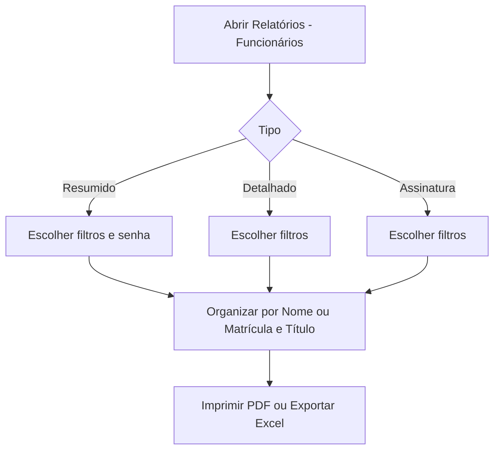

# Relatórios de Funcionários

## Objetivo

Emitir a **Relação de Colaboradores** em três formatos — **Resumido**, **Detalhado** e
**Assinatura** — com filtros por função, situação e mês de aniversário. Complementa o cadastro de
[Funcionários](../administrativo/funcionarios.md).

---

## Como acessar

```
Relatórios
→ Funcionários
```

---

## Quando utilizar

- Para conferir a lista de colaboradores ativos (ou desativados) da escola.
- Para imprimir uma **folha de assinaturas** (reuniões, recebimento de material, ponto).
- Para consultar dados completos de contato e as permissões de cada colaborador (Detalhado).
- Para listar aniversariantes do mês.

---

## Como utilizar

1. Abra **Relatórios → Funcionários**.
2. No topo, escolha o tipo: **Resumido** (já vem marcado), **Detalhado** ou **Assinatura**.
3. Em **Filtros**, escolha o **Mês de Aniversário**, marque as **Funções** desejadas
   (Administrativo, Professores, Coordenadores) e indique se quer colaboradores **Ativados**
   (Sim ou Não).
4. Em **Impressão**, escolha se a **senha** deve sair no relatório (só no tipo Resumido).
5. Em **Organização**, escolha **Organizar por** Nome ou Matrícula e, se quiser, digite um **Título**.
6. Clique no botão **Imprimir** para ver o PDF, ou no botão verde para exportar para o **Excel**.

*(Print sugerido: tela do relatório com os três tipos no topo e os grupos Filtros, Impressão e Organização.)*

---

## Tipos de relatório

| Tipo | Formato da folha | O que mostra |
|------|------------------|--------------|
| **Resumido** | Paisagem | Matrícula e situação, nome, apelido, data de nascimento, função e (opcional) senha |
| **Detalhado** | Paisagem | Dados completos: nome, matrícula e situação, endereço, e-mail, RG, CPF, nascimento, bairro, telefone, sexo, CEP, estado civil, função, cargo e as permissões do colaborador (coluna **Config.**) |
| **Assinatura** | Retrato | Matrícula, nome, apelido e um espaço em branco para **assinar** |

Em todos os tipos, a coluna de matrícula traz a situação ao lado: **A** (ativado) ou **D**
(desativado). O relatório termina com a **quantidade de colaboradores** listados.

A coluna **Config.** do Detalhado lista, uma embaixo da outra, as permissões marcadas no
cadastro do colaborador: *Prof x Turma*, *Cad. Agenda*, *Atend. App*, *Adm. OS*, *Cad. OS* e
*Ag/ At Visit*.

---

## Filtros e opções

| Opção | Descrição |
|-------|-----------|
| Mês de Aniversário | Mostra só os aniversariantes do mês escolhido. **Todos** não filtra |
| Função | Administrativo, Professores e Coordenadores. Sem nenhuma marcada, entram todos; marcando mais de uma, entra quem tiver **qualquer uma** delas |
| Ativado (Sim / Não) | **Sim** (padrão) lista os colaboradores ativos; **Não** lista os desativados |
| Imprimir senha (Sim / Não) | Inclui a senha do colaborador no relatório. Só funciona no tipo **Resumido**; nos demais fica bloqueado em **Não** |
| Organizar por (Nome / Matrícula) | Ordem da lista. Padrão: **Nome** |
| Título | Texto livre que aparece no cabeçalho, em letras maiúsculas |

---

## Botões

| Botão | O que faz |
|-------|-----------|
| **Imprimir** (ícone de impressora) | Gera o relatório em PDF e abre numa janela |
| **Exportar para Excel** (ícone verde) | Baixa uma planilha *Colaboradores* com nome, matrícula, situação, apelido, data de nascimento, sexo e cargo |

---

## Resultados

- Relatório em PDF no tipo, no filtro e na ordem escolhidos, com o título e o total de colaboradores.
- A planilha do Excel usa apenas o **Mês de Aniversário**: os demais filtros (função, ativado, ordem) **não** são aplicados a ela.

---

## Regras importantes

- Por padrão o relatório lista só colaboradores **ativos**. Para ver os desativados, marque **Ativado: Não**.
- A opção **Imprimir senha** só está disponível no tipo **Resumido** e volta para **Não** sempre que você troca de tipo.
- Os tipos **Senhas** e **Censo**, que existiam antes, **não fazem mais parte** da tela.
- O filtro por período de contratação também foi retirado.

:::warning Cuidado com a senha impressa
Quem imprime o relatório com **Imprimir senha: Sim** expõe a senha dos colaboradores no papel. Use
somente quando necessário e guarde ou destrua a folha depois.
:::

---

## Mensagens do sistema

**Alerta**
- *"Nenhum funcionário encontrado"* — *"Não há funcionários que correspondam aos critérios de filtro."*

**Erro**
- *"Erro"* — *"Erro ao gerar relatório"*

---

## Fluxo da funcionalidade



---

## Exemplos práticos

**Exemplo 1:** folha de assinaturas dos **professores** ativos, ordenada por nome — escolha
**Assinatura**, marque **Professores**, deixe **Ativado: Sim** e clique em **Imprimir**.

**Exemplo 2:** conferir quem está com acesso ao aplicativo e à agenda — escolha **Detalhado** e
veja a coluna **Config.** de cada colaborador.

---

## Dicas

- Use **Mês de Aniversário** para ações de RH/endomarketing.
- Para uma lista de contatos completa, o **Detalhado** traz endereço, telefone e e-mail.
- Para listar quem já saiu da escola, use **Ativado: Não**.

---

## Erros comuns

- **Apareceu "Nenhum funcionário encontrado"** → revise os filtros; lembre que o padrão é só **Ativados**.
- **O Excel veio com mais pessoas que o PDF** → a planilha só respeita o mês de aniversário.
- **No tipo Assinatura escolhi Matrícula, mas a lista saiu por nome** → comportamento em verificação; confira a ordem no PDF.

---

## FAQ

**Onde cadastro os funcionários?**
Em [Funcionários](../administrativo/funcionarios.md), no módulo Administrativo.

**Sumiram as opções Senhas e Censo. Como listo as senhas?**
Use o tipo **Resumido** com **Imprimir senha: Sim**. Para o censo, use o **Detalhado**.

---

## Prints

- [ ] Opções do relatório (tipos, Filtros, Impressão, Organização).
- [ ] Relatório Resumido gerado.
- [ ] Relatório Detalhado gerado (coluna Config.).
- [ ] Relatório de Assinatura gerado.

---

## Histórico

| Data | Alteração |
|------|-----------|
| 30/07/2026 | Página criada. |
| 07/10/2026 | Reescrita: tipos **Resumido**, **Detalhado** (novo layout com coluna Config.) e **Assinatura**; filtros de **Função** e **Ativado**; **Imprimir senha**; **Organizar por**. Removidos **Senhas**, **Censo** e o período. |
