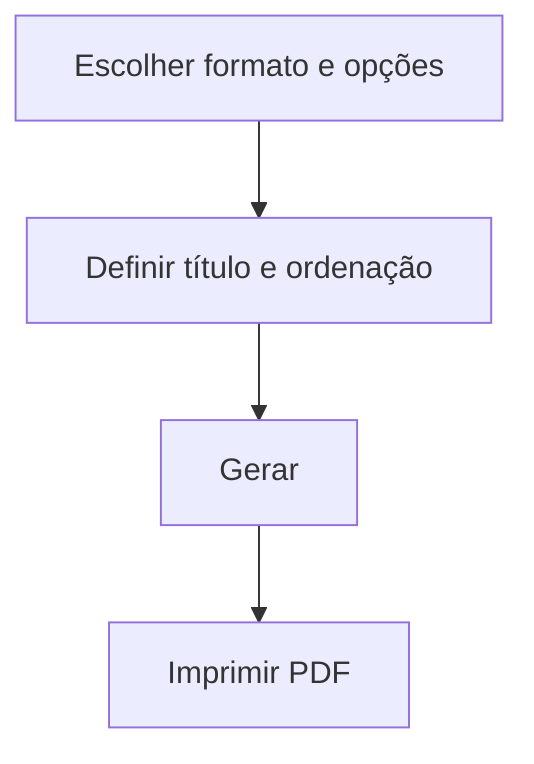

# Relatórios de Funcionários

## Objetivo

Emitir listagens de **funcionários** — resumidas ou detalhadas, para censo, aniversariantes,
assinaturas ou controle de senhas/operadores. Complementa o cadastro de
[Funcionários](../administrativo/funcionarios.md).

---

## Como acessar

```
Relatórios
→ Funcionários
```

---

## Quando utilizar

- Para gerar listas de funcionários (censo, aniversariantes, folha de assinaturas).

---

## Como utilizar

1. Abra **Relatórios → Funcionários**.
2. Escolha o formato: **Resumido** ou **Detalhado**.
3. Selecione as opções: **Censo**, **Mês de Aniversário**, **Assinatura**, **Senhas**,
   e a ordenação (**Nome**, **Nº de Matrícula**).
4. Informe o **Título** do relatório.
5. Gere e imprima.

---

## Filtros e opções

| Opção | Descrição |
|-------|-----------|
| Resumido / Detalhado | Nível de detalhe |
| Censo | Formato para censo |
| Mês de Aniversário | Filtra aniversariantes |
| Assinatura | Inclui coluna de assinatura |
| Senhas | Lista de operadores/senhas |
| Ordenação (Nome / Nº de Matrícula) | Ordem da lista |
| Título | Título do relatório |

---

## Botões

| Botão | O que faz |
|-------|-----------|
| **Gerar/Imprimir** | Produz o relatório em PDF |

---

## Resultados

- Lista de funcionários no formato e ordenação escolhidos.

---

## Regras importantes

- O relatório reflete os funcionários **cadastrados** e sua situação (ativos/inativos).

---

## Fluxo da funcionalidade



---

## Exemplos práticos

**Exemplo:** gerar uma **folha de assinaturas** dos funcionários ativos, ordenada por nome.

---

## Dicas

- Use **Mês de Aniversário** para ações de RH/endomarketing.

---

## FAQ

**Onde cadastro os funcionários?**
Em [Funcionários](../administrativo/funcionarios.md), no módulo Administrativo.

---

## Prints

- [ ] Opções do relatório.
- [ ] Relatório gerado.

---

## Histórico

| Data | Alteração |
|------|-----------|
| 30/07/2026 | Página criada. |
