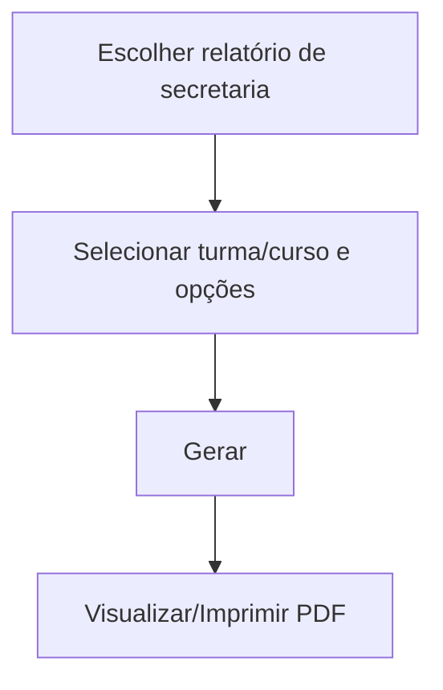

# Relatórios de Secretaria

## Objetivo

Emitir os documentos e listagens acadêmicas da secretaria: **Alunos por Turma**, **Informações de
Matrícula**, **Boletim Escolar**, e relatórios de **Frequência** (Diário de Classe, Frequência de
Prova). São os documentos do dia a dia da secretaria e da coordenação.

---

## Como acessar

```
Relatórios
→ Secretaria
→ (Alunos / Documentos / Frequências)
```

---

## Quando utilizar

- Para imprimir listas de alunos, chamadas/diários, boletins e comprovantes de matrícula.

---

## Como utilizar

1. Abra **Relatórios → Secretaria** e escolha o relatório desejado.
2. Selecione os filtros (turma, curso, período, tipo de ordenação, opções de exibição).
3. Gere e visualize/imprima o PDF.

---

## Relatórios disponíveis

### Alunos por Turma
Lista os alunos de uma ou mais turmas. Opções: ordenar por **Turma + Nome** ou **Turma + Nº
Ordem**; exibir **Mãe/Pai**, **Responsável Acadêmico/Financeiro**, **Mês de Aniversário**;
**imprimir uma turma por página**; filtrar **turmas regulares/auxiliares**.

### Informações de Matrícula
Comprovante/ficha com os dados da matrícula do aluno (curso, turma, plano, responsáveis).

### Boletim Escolar
Emite o **boletim** (Individual ou Listagem), com opções como **Foto do Aluno**, **Imprimir
Assinatura**, **Data de Emissão** e filtro por situação (Matriculado, Aprovado, etc.).
Depende do [processamento do boletim](../boletim/processamento.md).

### Frequências (Diário de Classe / Frequência de Prova)
Imprime o **Diário de Classe** da turma e a **Frequência de Prova**, para registro e assinatura.

---

## Filtros (principais)

| Filtro | Descrição |
|--------|-----------|
| Turma / Curso | Escopo do relatório |
| Ordenação (Turma+Nome / Turma+Nº Ordem) | Ordem dos alunos |
| Exibir Mãe/Pai/Responsáveis | Colunas adicionais |
| Uma turma por página | Quebra por turma |
| Situação | Filtra alunos por situação |
| Boletim Individual / Listagem | Formato do boletim |
| Foto do Aluno / Assinatura | Opções de impressão |

---

## Botões

| Botão | O que faz |
|-------|-----------|
| **Gerar/Imprimir** | Produz o relatório em PDF |
| **Fechar** | Fecha a visualização |

---

## Resultados

- O documento é gerado em PDF, pronto para impressão/entrega.

---

## Regras importantes

- O **Boletim Escolar** exige que a turma tenha sido **processada** (ver [Boletim](../boletim/processamento.md)).
- Listas de alunos refletem a **situação** e a **numeração de ordem** atuais — organize a ordem antes
  (ver [Organiza Número de Ordem](../secretaria/organiza-numero-ordem.md)).

---

## Fluxo da funcionalidade



---

## Exemplos práticos

**Exemplo:** imprimir o **Diário de Classe** de todas as turmas (uma por página) para os
professores; emitir o **Boletim** individual de um aluno com foto e assinatura.

---

## Dicas

- Antes de imprimir chamadas/diários, rode [Organiza Número de Ordem](../secretaria/organiza-numero-ordem.md).
- Confira o **processamento do boletim** antes de imprimir boletins.

---

## FAQ

**O boletim saiu sem as últimas notas. Por quê?**
A turma precisa ser **reprocessada** após as alterações (ver [Processamento do Boletim](../boletim/processamento.md)).

---

## Prints

- [ ] Filtros de Alunos por Turma.
- [ ] Boletim Escolar (opções).
- [ ] Diário de Classe.

---

## Histórico

| Data | Alteração |
|------|-----------|
| 30/07/2026 | Página criada. |
