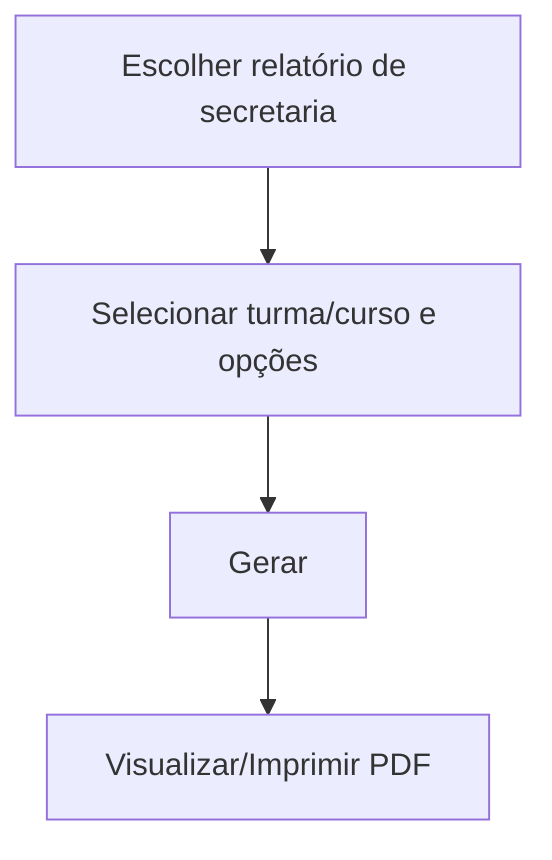

# Relatórios de Secretaria

## Objetivo

Emitir os documentos e listagens acadêmicas da secretaria: **Alunos por Turma**, **Informações de
Matrícula**, **Boletim Escolar**, e relatórios de **Frequência** (Diário de Classe, Frequência de
Prova). São os documentos do dia a dia da secretaria e da coordenação.

---

## Como acessar

```
Relatórios
→ Secretaria
→ (Alunos / Documentos / Frequências)
```

---

## Quando utilizar

- Para imprimir listas de alunos, chamadas/diários, boletins e comprovantes de matrícula.

---

## Como utilizar

1. Abra **Relatórios → Secretaria** e escolha o relatório desejado.
2. Selecione os filtros (turma, curso, período, tipo de ordenação, opções de exibição).
3. Gere e visualize/imprima o PDF.

---

## Relatórios disponíveis

### Alunos por Turma
Lista os alunos de uma ou mais turmas. Opções:
- **Tipo de turma:** *Somente Turmas Regulares* ou *Somente Turmas Auxiliares*.
- **Situação** (Matriculado, Cancelado, Abandono, Transferido, Trancado, Registrado), **Turma** e **Turno**.
- **Imprimir o Nº de Ordem**, **o Total de Alunos**, **a Situação** e **Dados Pessoais** (Sim/Não).
- **Imprimir o Nome** do responsável sob o nome do aluno: *Resp. Finan.*, *Resp. Academ.*, *Pai* ou *Mãe*.
- **Imprimir uma turma por página**.
- **Classificado por:** *Turma + Nº Ordem* ou *Turma + Nome*.
- **Título personalizado do relatório** (novo), que sai em maiúsculas no cabeçalho.

Na folha, a coluna **Matrícula / Sit** mostra a matrícula com a situação (ex.: *123 - M*). Com
**Dados Pessoais** ativado saem também **Dt. Nasc.**, **CPF**, **Plano Pgto.**, **Convênio** e
**D. Venc.** O nome do responsável escolhido aparece em letra pequena, abaixo do nome do aluno.

> Os filtros **Nível/Escolaridade** e **Mês de Aniversário** foram retirados desta tela.

**Turmas Auxiliares:** ao escolher *Somente Turmas Auxiliares*, o sistema troca o seletor para
turmas auxiliares e **bloqueia** o que não se aplica a elas: Turno, Situação, Nº de Ordem,
Situação e Dados Pessoais (ficam em *Não*), o nome do responsável e a ordenação por Nº Ordem
(fica só *Turma + Nome*). Voltando para *Regulares*, tudo é liberado de novo.

### Relação de Assinaturas
Mesma tela e mesmos filtros do Alunos por Turma, mas a folha traz uma coluna em branco para o
aluno (ou responsável) **assinar**. Título do PDF: *RELAÇÃO DE ASSINATURAS*, com a ordenação
usada (Nº Ordem ou Nome).

*(Print sugerido: tela de Alunos por Turma com tipo de turma, Situação e Configurações; e uma versão com Turmas Auxiliares selecionadas.)*

### Informações de Matrícula
Comprovante/ficha com os dados da matrícula do aluno (curso, turma, plano, responsáveis).

### Boletim Escolar
Emite o **boletim** (Individual ou Listagem), com opções como **Foto do Aluno**, **Imprimir
Assinatura**, **Data de Emissão** e filtro por situação (Matriculado, Aprovado, etc.).
Depende do [processamento do boletim](../boletim/processamento.md).

### Frequências (Diário de Classe / Frequência de Prova)
Imprime o **Diário de Classe** da turma e a **Frequência de Prova**, para registro e assinatura.

---

## Filtros (principais)

| Filtro | Descrição |
|--------|-----------|
| Turma / Curso | Escopo do relatório |
| Ordenação (Turma+Nome / Turma+Nº Ordem) | Ordem dos alunos |
| Tipo de turma (Regulares / Auxiliares) | Define o seletor de turma e libera ou bloqueia opções |
| Imprimir o Nome (Resp. Finan. / Resp. Academ. / Pai / Mãe) | Mostra o responsável sob o nome do aluno |
| Título personalizado | Texto no cabeçalho (Alunos por Turma e Assinaturas) |
| Uma turma por página | Quebra por turma |
| Situação | Filtra alunos por situação |
| Boletim Individual / Listagem | Formato do boletim |
| Foto do Aluno / Assinatura | Opções de impressão |

---

## Botões

| Botão | O que faz |
|-------|-----------|
| **Gerar/Imprimir** | Produz o relatório em PDF |
| **Fechar** | Fecha a visualização |

---

## Resultados

- O documento é gerado em PDF, pronto para impressão/entrega.

---

## Regras importantes

- O **Boletim Escolar** exige que a turma tenha sido **processada** (ver [Boletim](../boletim/processamento.md)).
- Em Alunos por Turma, o sistema avisa *"Nenhum registro encontrado para os filtros selecionados."* quando não há alunos.
- Listas de alunos refletem a **situação** e a **numeração de ordem** atuais — organize a ordem antes
  (ver [Organiza Número de Ordem](../secretaria/organiza-numero-ordem.md)).

---

## Fluxo da funcionalidade



---

## Exemplos práticos

**Exemplo:** imprimir o **Diário de Classe** de todas as turmas (uma por página) para os
professores; emitir o **Boletim** individual de um aluno com foto e assinatura.

---

## Dicas

- Antes de imprimir chamadas/diários, rode [Organiza Número de Ordem](../secretaria/organiza-numero-ordem.md).
- Confira o **processamento do boletim** antes de imprimir boletins.

---

## FAQ

**O boletim saiu sem as últimas notas. Por quê?**
A turma precisa ser **reprocessada** após as alterações (ver [Processamento do Boletim](../boletim/processamento.md)).

---

## Prints

- [ ] Filtros de Alunos por Turma.
- [ ] Alunos por Turma com Turmas Auxiliares (campos bloqueados).
- [ ] Relação de Assinaturas gerada.
- [ ] Boletim Escolar (opções).
- [ ] Diário de Classe.

---

## Histórico

| Data | Alteração |
|------|-----------|
| 30/07/2026 | Página criada. |
| 07/10/2026 | **Alunos por Turma:** novo campo de **Título**, nova coluna **Matrícula / Sit**, dados de plano, convênio e vencimento, responsável sob o nome, bloqueios para **Turmas Auxiliares**; retirados **Nível** e **Mês de Aniversário**. Incluída a **Relação de Assinaturas**. |
