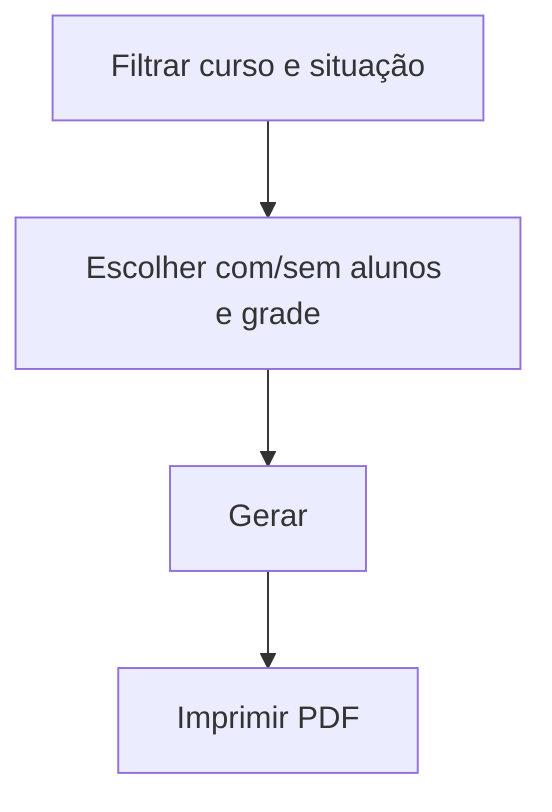

# Relatório de Turma Regular

## Objetivo

Emitir a **listagem das turmas** da escola, com opções de exibir a **grade** e os **alunos** de
cada turma, e filtrar por situação (ativas/encerradas). Útil para conferência da estrutura de
turmas do período.

---

## Quem pode utilizar

Secretaria, Coordenação e Administrador.

---

## Como acessar

```
Relatórios
→ Turma Regular
```

---

## Quando utilizar

- Para conferir as turmas do período, com ou sem alunos/grade.

---

## Como utilizar

1. Abra **Relatórios → Turma Regular**.
2. Filtre por **Curso** e pela situação: **Todas as Turmas**, **Somente Turmas Ativas** ou
   **Somente Turmas Encerradas**.
3. Escolha exibir **Com Alunos / Sem Alunos** e **Com Grade / Sem Grade**.
4. Informe o **Título** e gere o relatório.

---

## Filtros e opções

| Opção | Descrição |
|-------|-----------|
| Curso | Filtra por curso |
| Todas / Ativas / Encerradas | Situação das turmas |
| Com Alunos / Sem Alunos | Inclui a lista de alunos |
| Com Grade / Sem Grade | Inclui a grade de disciplinas |
| Título | Título do relatório |

---

## Botões

| Botão | O que faz |
|-------|-----------|
| **Gerar/Imprimir** | Produz o relatório em PDF |

---

## Resultados

- Listagem das turmas conforme os filtros, opcionalmente com alunos e grade.

---

## Regras importantes

- Reflete as turmas cadastradas em [Turmas](../academico/turmas.md) e sua situação (ativa/encerrada).

---

## Fluxo da funcionalidade



---

## Exemplos práticos

**Exemplo:** listar todas as turmas ativas do Ensino Fundamental **com alunos**, para conferência.

---

## Dicas

- Use **Sem Alunos / Sem Grade** para uma visão enxuta só das turmas.

---

## FAQ

**Onde crio/edito as turmas?**
Em [Turmas](../academico/turmas.md), no módulo Acadêmico.

---

## Prints

- [ ] Filtros do relatório.
- [ ] Relatório gerado.

---

## Histórico

| Data | Alteração |
|------|-----------|
| 30/07/2026 | Página criada. |
