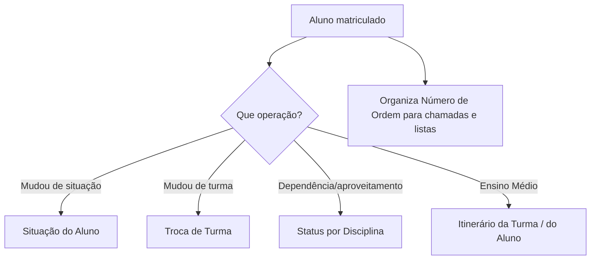

# Módulo Secretaria / Outras Atividades

## Objetivo

O módulo **Secretaria / Outras Atividades** reúne as operações do dia a dia da secretaria escolar
sobre alunos já matriculados: mudar a **situação** do aluno (trancamento, transferência,
cancelamento), fazer a **troca de turma**, ajustar o **status por disciplina** (dependências,
aproveitamento), organizar o **número de ordem** das turmas, cadastrar **disciplinas
complementares** e gerenciar os **itinerários formativos** por turma e por aluno.

## Quem pode utilizar

Secretaria, Coordenação e Administrador.

## Como acessar

As telas ficam no grupo **Secretaria** (Outras Atividades) do menu lateral.

## Mapa do módulo

| Tela | Para que serve | Documentação |
|------|----------------|--------------|
| Situação do Aluno | Alterar a situação (trancado, transferido, cancelado...) | [Abrir](situacao-aluno.md) |
| Troca de Turma do Aluno | Mover o aluno para outra turma | [Abrir](troca-turma.md) |
| Status por Disciplina | Ajustar status/dependência por disciplina | [Abrir](status-por-disciplina.md) |
| Organiza Número de Ordem | Reorganizar a numeração de ordem das turmas | [Abrir](organiza-numero-ordem.md) |
| Disciplinas Complementares | Vincular disciplinas complementares ao aluno | [Abrir](disciplinas-complementares.md) |
| Itinerário da Turma | Definir o itinerário formativo da turma | [Abrir](itinerario-turma.md) |
| Itinerário do Aluno | Definir o itinerário formativo por aluno | [Abrir](itinerario-aluno.md) |

## Fluxo geral

---

## Histórico

| Data | Alteração |
|------|-----------|
| 30/07/2026 | Página criada. |
