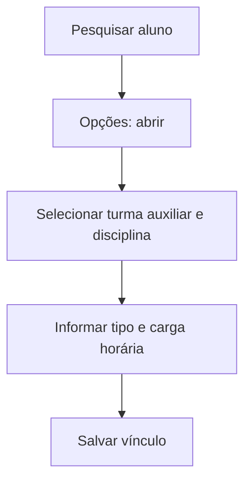

# Disciplinas Complementares

## Objetivo

Vincular a um aluno **disciplinas complementares** — disciplinas extras ou de reforço que não
fazem parte da grade regular da turma, geralmente associadas a uma **turma auxiliar**. Permite
registrar disciplina, matéria, tipo e carga horária.

---

## Como acessar

```
Secretaria
→ Disciplinas Complementares
```

---

## Quando utilizar

- Quando o aluno cursa disciplinas além da grade regular (reforço, optativas, atividades extras).

---

## Como utilizar

1. Abra **Disciplinas Complementares**.
2. Pesquise o aluno por **Nome** e clique em **Pesquisar**.
3. Use **Opções** para abrir o aluno.
4. Selecione a **Turma Auxiliar** e a **Disciplina** (e a **Matéria**, se houver).
5. Informe o **Tipo** e a **Carga Horária**.
6. Salve o vínculo.

---

## Campos e colunas

| Campo/Coluna | Descrição |
|--------------|-----------|
| Turma Auxiliar | Turma auxiliar da disciplina complementar |
| Disciplina | Disciplina complementar |
| Matéria | Matéria (quando aplicável) |
| Tipo | Tipo da disciplina |
| Carga Horária | Carga horária |
| Descrição | Descrição/observação |

---

## Botões

| Botão | O que faz |
|-------|-----------|
| **Pesquisar** | Localiza o aluno |
| **Opções** | Abre as disciplinas complementares do aluno |
| **Fechar** | Fecha a tela |

---

## Resultados

- As disciplinas complementares ficam vinculadas ao aluno e à turma auxiliar.

---

## Regras importantes

- É preciso selecionar uma **disciplina** e uma **turma auxiliar**.
- A disciplina complementar se apoia no cadastro de [Turma Auxiliar](../academico/turma-auxiliar.md).

---

## Mensagens do sistema

- *"Por favor, selecione uma DISCIPLINA."*
- *"Por favor, selecione uma TURMA AUXILIAR."*

---

## Fluxo da funcionalidade



---

## Exemplos práticos

**Exemplo:** vincular a um aluno a disciplina complementar "Reforço de Matemática" na turma
auxiliar correspondente.

---

## Dicas

- Cadastre antes a [Turma Auxiliar](../academico/turma-auxiliar.md) que receberá a disciplina complementar.

---

## Erros comuns

- **"Por favor, selecione uma DISCIPLINA / TURMA AUXILIAR."** → selecione ambos antes de salvar.

---

## FAQ

**Qual a diferença para disciplinas complementares no cadastro?**
Aqui o vínculo é **por aluno**; o cadastro base de disciplinas fica no módulo [Acadêmico](../academico/disciplinas.md).

---

## Prints

- [ ] Lista de alunos.
- [ ] Vínculo de disciplina complementar.

---

## Histórico

| Data | Alteração |
|------|-----------|
| 30/07/2026 | Página criada. |
