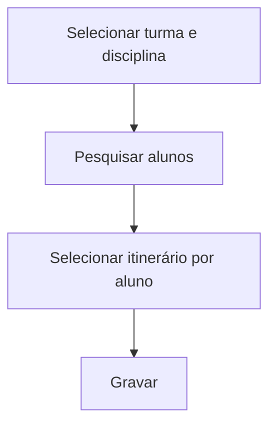

# Itinerário do Aluno

## Objetivo

Definir o **itinerário formativo por aluno** — quando cada estudante do Ensino Médio segue
itinerários/disciplinas diferentes dentro da mesma turma. Complementa o [Itinerário da
Turma](itinerario-turma.md) para casos individuais.

---

## Como acessar

```
Secretaria
→ Itinerário do Aluno
```

---

## Quando utilizar

- Quando os alunos de uma turma têm itinerários formativos distintos.

---

## Como utilizar

1. Abra **Itinerário do Aluno**.
2. Selecione a **Turma** e a **Disciplina**.
3. Clique em **Pesquisar** para listar os alunos.
4. Para cada aluno, selecione os **Itinerários** correspondentes.
5. Clique em **Gravar**.

---

## Campos e colunas

| Campo/Coluna | Descrição |
|--------------|-----------|
| Selecione a Turma | Turma |
| Selecione a Disciplina | Disciplina do itinerário |
| Matrícula / Nome | Identificação do aluno |
| Itinerários | Itinerário(s) vinculado(s) ao aluno |

---

## Botões

| Botão | O que faz |
|-------|-----------|
| **Pesquisar** | Lista os alunos da turma |
| **Gravar** | Salva os itinerários por aluno |

---

## Resultados

- Cada aluno fica com o(s) seu(s) itinerário(s) formativo(s) registrado(s).

---

## Regras importantes

- Depende do cadastro de [Itinerário Formativo](../academico/itinerario-formativo.md).
- Complementa a definição por turma quando há variação entre alunos.

---

## Fluxo da funcionalidade



---

## Exemplos práticos

**Exemplo:** na turma "3º Ano B", vincular metade dos alunos ao itinerário "Humanas" e a outra
metade a "Matemática".

---

## Dicas

- Para itinerário único da turma inteira, use [Itinerário da Turma](itinerario-turma.md) (mais rápido).

---

## FAQ

**Posso trocar o itinerário de um aluno depois?**
Sim, basta reabrir a tela, ajustar e gravar novamente.

---

## Prints

- [ ] Lista de alunos.
- [ ] Seleção de itinerários por aluno.

---

## Histórico

| Data | Alteração |
|------|-----------|
| 30/07/2026 | Página criada. |
