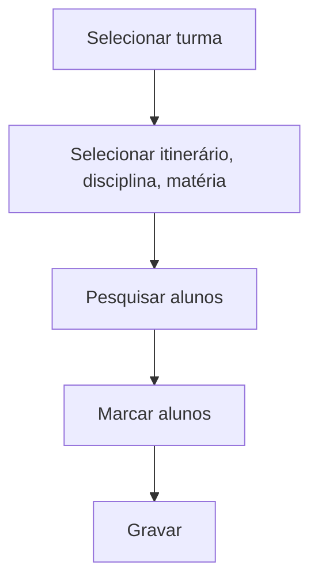

# Itinerário da Turma

## Objetivo

Definir, para uma **turma** do Novo Ensino Médio, quais **disciplinas** compõem o **itinerário
formativo** e vincular os alunos. Permite marcar em lote os alunos da turma a um itinerário e às
disciplinas/matérias correspondentes.

---

## Quem pode utilizar

Secretaria e Coordenação.

---

## Como acessar

```
Secretaria
→ Itinerário da Turma
```

---

## Quando utilizar

- Ao organizar os itinerários formativos de uma turma do Ensino Médio.

---

## Como utilizar

1. Abra **Itinerário da Turma**.
2. Selecione a **Turma** (e a **Turma Secundária**, se aplicável).
3. Selecione o **Itinerário Formativo**, a **Disciplina** e a **Matéria** (se houver).
4. Clique em **Pesquisar** para listar os alunos.
5. Marque os alunos (ou use **Marcar Todos**).
6. Clique em **Gravar**.

---

## Campos e colunas

| Campo/Coluna | Descrição |
|--------------|-----------|
| Selecione a Turma | Turma |
| Selecione a Turma Secundária | Turma secundária (quando aplicável) |
| Selecione o Itinerário Formativo | Itinerário a vincular |
| Selecione a Disciplina / Matéria | Disciplina e matéria do itinerário |
| CHR | Carga horária |
| Matrícula / Nome | Identificação do aluno |

---

## Botões

| Botão | O que faz |
|-------|-----------|
| **Pesquisar** | Lista os alunos da turma |
| **Marcar Todos** | Marca todos os alunos |
| **Gravar** | Salva os vínculos de itinerário |

---

## Resultados

- Os alunos ficam vinculados ao itinerário formativo e às disciplinas correspondentes.

---

## Regras importantes

- Depende do cadastro de [Itinerário Formativo](../academico/itinerario-formativo.md) e de
  disciplinas marcadas como **itinerário**.
- A turma deve estar configurada para **exigir itinerário formativo** (ver [Turmas](../academico/turmas.md)).

---

## Fluxo da funcionalidade



---

## Exemplos práticos

**Exemplo:** vincular toda a turma "3º Ano A" ao itinerário "Ciências da Natureza", nas
disciplinas do aprofundamento.

---

## Dicas

- Use **Marcar Todos** quando o itinerário vale para a turma inteira.

---

## FAQ

**E se cada aluno tiver um itinerário diferente?**
Use [Itinerário do Aluno](itinerario-aluno.md) para vínculos individuais.

---

## Prints

- [ ] Seleção de turma e itinerário.
- [ ] Lista de alunos marcados.

---

## Histórico

| Data | Alteração |
|------|-----------|
| 30/07/2026 | Página criada. |
