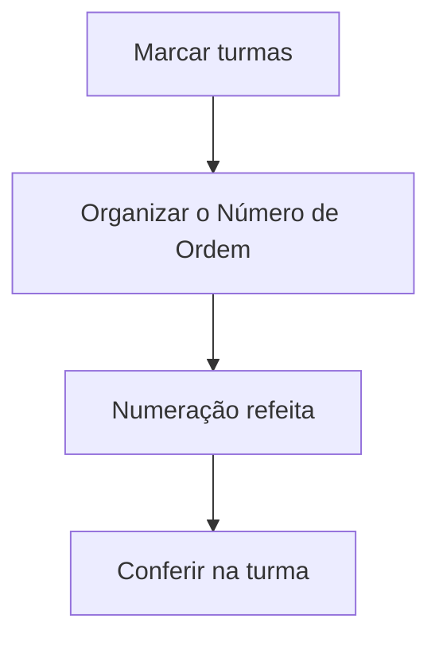

# Organiza Número de Ordem

## Objetivo

**Reorganizar a numeração de ordem** dos alunos nas turmas — o número que aparece nas chamadas,
listas e diários. Útil após matrículas, trocas de turma ou saídas, para deixar a sequência
correta (geralmente em ordem alfabética).

---

## Quem pode utilizar

Secretaria e Coordenação.

---

## Como acessar

```
Secretaria
→ Organiza Número de Ordem
```

---

## Quando utilizar

- Depois de incluir/remover alunos ou fazer trocas de turma.
- No início do período, para numerar as turmas.

---

## Como utilizar

1. Abra **Organiza Número de Ordem**.
2. Marque as turmas em **Organizar Numeração?** (ou use **Selecionar Todas as Turmas**).
3. Clique em **Organizar o Número de Ordem**.
4. Para conferir, abra a turma e veja a lista com **Ordem**, **Matrícula**, **Nome** e **Situação**.

---

## Campos e colunas

| Campo/Coluna | Descrição |
|--------------|-----------|
| Turma / Descrição | Turma |
| Qtde. Alunos | Quantidade de alunos na turma |
| Último Número | Último número de ordem usado |
| Organizar Numeração? | Marca a turma para reorganizar |
| Ordem / Matrícula / Nome / Situação | Detalhe dos alunos (ao abrir a turma) |

---

## Botões

| Botão | O que faz |
|-------|-----------|
| **Selecionar Todas as Turmas** | Marca todas as turmas |
| **Organizar o Número de Ordem** | Executa a reorganização das turmas marcadas |
| **Fechar** | Fecha a visualização da turma |

---

## Resultados

- A numeração de ordem das turmas selecionadas é refeita em sequência.

---

## Regras importantes

- A reorganização afeta a **ordem exibida** em chamadas, listas e diários.
- Rode após mudanças de composição das turmas para manter a sequência correta.

---

## Fluxo da funcionalidade



---

## Exemplos práticos

**Exemplo:** após incluir 3 novos alunos em várias turmas, marcar todas e reorganizar a numeração.

---

## Dicas

- Reorganize **antes** de imprimir chamadas/diários para evitar números fora de ordem.

---

## FAQ

**A numeração é alfabética?**
Segue o critério configurado pela escola (normalmente alfabético).

---

## Prints

- [ ] Seleção de turmas.
- [ ] Lista de alunos com a nova ordem.

---

## Histórico

| Data | Alteração |
|------|-----------|
| 30/07/2026 | Página criada. |
