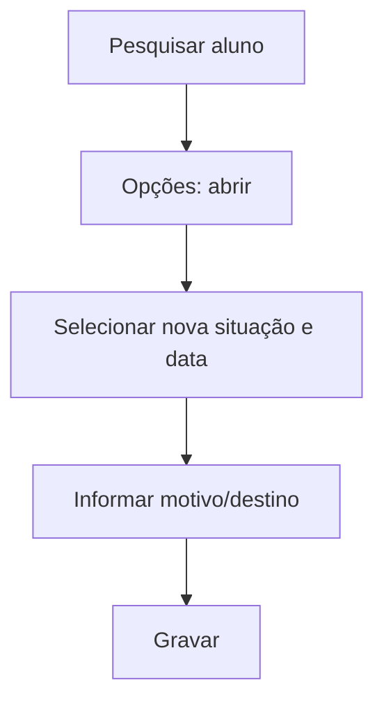

# Situação do Aluno

## Objetivo

Alterar a **situação** de um aluno matriculado — por exemplo **trancado**, **transferido**,
**cancelado**, **abandono** — registrando a data, o motivo e (quando for transferência) o
estabelecimento de destino. É a forma oficial de mudar o vínculo do aluno com a escola.

---

## Como acessar

```
Secretaria
→ Situação do Aluno
```

---

## Quando utilizar

- Quando o aluno tranca, é transferido, cancela a matrícula ou abandona.

---

## Como utilizar

1. Abra **Situação do Aluno**.
2. Filtre por **Turma** e **Situação** e use **Pesquisar** para localizar o aluno.
3. Use **Opções** para abrir o aluno.
4. Selecione a nova **Situação** e informe a **Data de Alteração**.
5. Preencha **Motivo / Estabelecimento de Destino** quando aplicável.
6. Clique em **Gravar**.

---

## Campos

| Campo | Descrição | Obrigatório | Observações |
|-------|-----------|-------------|-------------|
| Matrícula / Nome | Identificação do aluno | — | Preenchidos pelo sistema |
| Situação | Nova situação do aluno | Sim | Trancado, transferido, cancelado, etc. |
| Data de Alteração / Data | Data da mudança | Sim | |
| Hora | Hora da alteração | Não | |
| Motivo / Estabelecimento de Destino | Justificativa/destino | Condicional | Obrigatório em transferências |
| Operador | Usuário que registrou | — | Preenchido pelo sistema |

---

## Botões

| Botão | O que faz |
|-------|-----------|
| **Pesquisar** | Lista os alunos conforme os filtros |
| **Opções** | Abre o aluno para alterar a situação |
| **Gravar** | Salva a nova situação |
| **Cancelar** | Fecha sem salvar |

---

## Filtros e colunas

Filtros: **Turma**, **Situação**. Colunas: **Matrícula**, **Nome**, **Turma**, **Situação**.

---

## Resultados

- A situação do aluno é atualizada, com registro de data, operador e motivo.
- A mudança reflete nas listas, no boletim e nos boletos (conforme a situação).

---

## Regras importantes

- **Situação** e **Data** são obrigatórias.
- Em transferências, informe o **estabelecimento de destino**.
- Mudar a situação pode afetar cobrança, frequência e processamento do boletim.

---

## Fluxo da funcionalidade



---

## Exemplos práticos

**Exemplo:** registrar a transferência de um aluno, informando a data e a escola de destino.

---

## Dicas

- Registre o **motivo** com clareza — é o histórico oficial da mudança.

---

## FAQ

**Trancar o aluno interrompe a cobrança?**
Depende da política da escola; a mudança de situação é o gatilho, mas o tratamento financeiro
segue as regras definidas no Financeiro.

---

## Prints

- [ ] Lista de alunos com filtros.
- [ ] Formulário de alteração de situação.

---

## Histórico

| Data | Alteração |
|------|-----------|
| 30/07/2026 | Página criada. |
