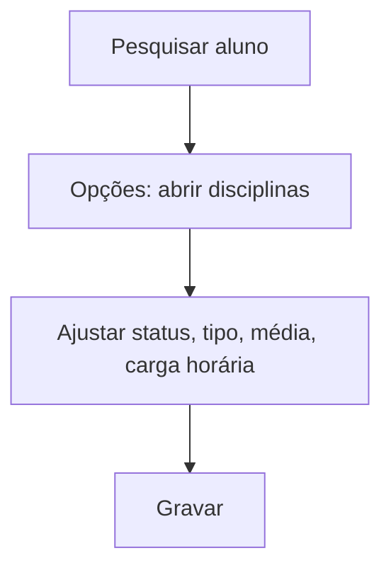

# Status por Disciplina

## Objetivo

Ajustar o **status de cada disciplina** de um aluno — por exemplo marcar **dependência**,
**aproveitamento**, **tipo** de cursar e a **média**/**carga horária** consideradas. Usada para
situações individuais que fogem do fluxo normal de aprovação.

---

## Como acessar

```
Secretaria
→ Status por Disciplina
```

---

## Quando utilizar

- Para registrar dependências, adaptações ou aproveitamento de disciplinas de um aluno.

---

## Como utilizar

1. Abra **Status por Disciplina**.
2. Pesquise o aluno por **Nome** e clique em **Pesquisar**.
3. Use **Opções** para abrir o aluno.
4. Para cada **Disciplina**, ajuste o **Status**, o **Tipo**, a **Média** e a **Carga Horária**.
5. Clique em **Gravar**.

---

## Campos e colunas

| Campo/Coluna | Descrição |
|--------------|-----------|
| Disciplina | Disciplina do aluno |
| Status | Situação da disciplina (ex.: dependência, aproveitada) |
| Tipo | Tipo de cursar |
| Média | Média considerada |
| Carga Horária | Carga horária considerada |

---

## Botões

| Botão | O que faz |
|-------|-----------|
| **Pesquisar** | Localiza o aluno |
| **Opções** | Abre as disciplinas do aluno |
| **Gravar** | Salva o status por disciplina |
| **Fechar** | Fecha sem salvar |

---

## Resultados

- O status das disciplinas do aluno é atualizado, afetando aprovação e histórico.

---

## Regras importantes

- Ao informar um status que exige, **Média** e **Carga Horária** tornam-se obrigatórias.
- Alterações aqui impactam o resultado final e o histórico escolar.

---

## Mensagens do sistema

- *"Média Obrigatória para [disciplina]"*
- *"Carga Horária Obrigatória para [disciplina]"*

---

## Fluxo da funcionalidade



---

## Exemplos práticos

**Exemplo:** marcar que um aluno cursa "Matemática" em **dependência**, com a média e a carga
horária correspondentes.

---

## Dicas

- Preencha **Média** e **Carga Horária** sempre que o status exigir, para não travar a gravação.

---

## Erros comuns

- **"Média/Carga Horária Obrigatória para..."** → complete esses campos na disciplina indicada.

---

## FAQ

**Isso muda a nota lançada?**
Não diretamente; ajusta o **status** e os valores considerados para aprovação/histórico.

---

## Prints

- [ ] Lista de alunos.
- [ ] Status das disciplinas do aluno.

---

## Histórico

| Data | Alteração |
|------|-----------|
| 30/07/2026 | Página criada. |
