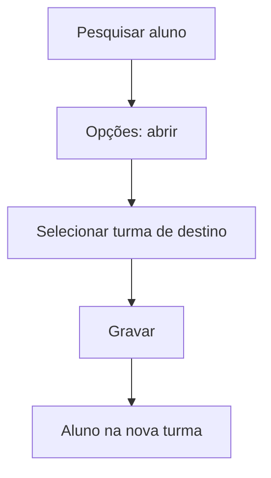

# Troca de Turma do Aluno

## Objetivo

Mover um aluno **de uma turma para outra**, mantendo sua matrícula e histórico. Usada quando o
aluno muda de turma no mesmo curso/período (por remanejamento, mudança de turno, etc.).

---

## Como acessar

```
Secretaria
→ Troca de Turma do Aluno
```

---

## Quando utilizar

- Quando o aluno precisa ser remanejado para outra turma.

---

## Como utilizar

1. Abra **Troca de Turma do Aluno**.
2. Pesquise o aluno por **Nome do Aluno** e clique em **Pesquisar**.
3. Use **Opções** para abrir o aluno.
4. Selecione a **Turma** de destino.
5. Clique em **Gravar**.

---

## Campos

| Campo | Descrição | Obrigatório |
|-------|-----------|-------------|
| Nome do Aluno | Aluno a ser movido | Sim |
| Turma (destino) | Turma para onde o aluno será movido | Sim |

---

## Botões

| Botão | O que faz |
|-------|-----------|
| **Pesquisar** | Localiza o aluno |
| **Opções** | Abre o aluno para trocar de turma |
| **Gravar** | Efetiva a troca de turma |
| **Cancelar** | Fecha sem salvar |

---

## Filtros e colunas

Colunas: **Matrícula**, **Nome**, **Turma**, **Situação**.

---

## Resultados

- O aluno passa a pertencer à nova turma, mantendo matrícula e histórico.

---

## Regras importantes

- **A Turma de destino é obrigatória.**
- A troca reorganiza o vínculo do aluno; confira número de ordem e frequência após a mudança.

---

## Mensagens do sistema

- *"Campo Turma Destino é obrigatório!"*

---

## Fluxo da funcionalidade



---

## Exemplos práticos

**Exemplo:** mover um aluno do "6º Ano A" para o "6º Ano B" por ajuste de turma.

---

## Dicas

- Após a troca, use [Organiza Número de Ordem](organiza-numero-ordem.md) para renumerar as turmas afetadas.

---

## Erros comuns

- **"Campo Turma Destino é obrigatório!"** → selecione a turma de destino antes de gravar.

---

## FAQ

**A troca apaga as notas/frequência já lançadas?**
Não; o objetivo é remanejar o aluno preservando os registros. Verifique consistência após a troca.

---

## Prints

- [ ] Lista de alunos.
- [ ] Seleção da turma de destino.

---

## Histórico

| Data | Alteração |
|------|-----------|
| 30/07/2026 | Página criada. |
