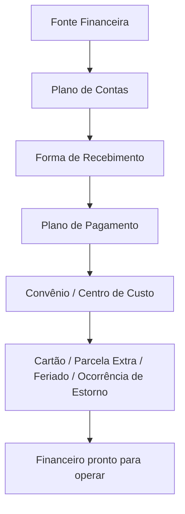

# Módulo Tabelas Financeiras

## Objetivo

As **Tabelas Financeiras** são os **cadastros de apoio** que sustentam todo o módulo
[Financeiro](../financeiro/README.md): as fontes (caixa/banco), o plano de contas, as formas de
recebimento, os planos de pagamento, os convênios, os cartões, os centros de custo e as demais
tabelas usadas nos lançamentos. São configuradas no início e ajustadas conforme a necessidade.

## Como acessar

As telas ficam no grupo **Tabelas** (Financeiro) do menu lateral.

## Mapa do módulo

| Tela | Para que serve | Documentação |
|------|----------------|--------------|
| Fonte Financeira | Cadastrar caixas e contas bancárias (fontes) | [Abrir](fonte-financeira.md) |
| Plano de Contas | Estrutura de contas de receita/despesa | [Abrir](plano-contas.md) |
| Forma de Recebimento | Formas de pagamento/recebimento (dinheiro, cartão, PIX...) | [Abrir](forma-recebimento.md) |
| Plano de Pagamento | Condições de parcelamento das mensalidades | [Abrir](plano-pagamento.md) |
| Convênio | Convênios de desconto | [Abrir](convenio.md) |
| Centro de Custo | Centros de custo das despesas | [Abrir](centro-custo.md) |
| Cartão | Máquinas/tipos de cartão para recebimento | [Abrir](cartao.md) |
| Cartão Institucional | Cartões da escola para pagamentos | [Abrir](cartao-institucional.md) |
| Parcela Extra | Parcelas avulsas (negociação, dependência) | [Abrir](parcela-extra.md) |
| Feriado Financeiro | Feriados que afetam vencimentos | [Abrir](feriado-financeiro.md) |
| Ocorrência de Estorno | Motivos de estorno padronizados | [Abrir](ocorrencia-estorno.md) |

## Ordem recomendada de configuração

---

## Histórico

| Data | Alteração |
|------|-----------|
| 30/07/2026 | Página criada. |
