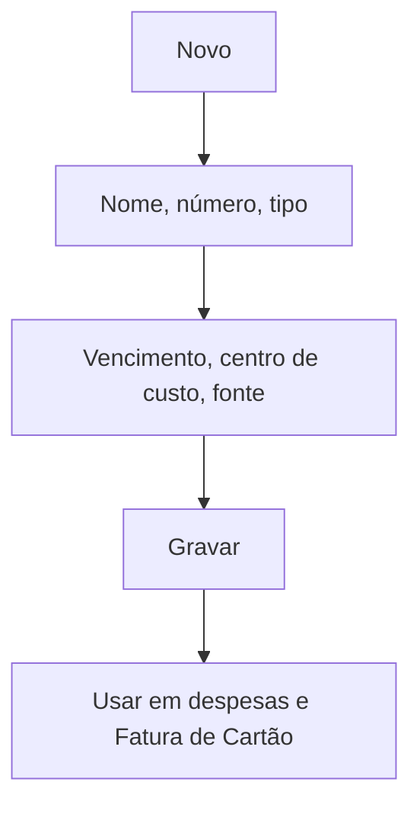

# Cartão Institucional

## Objetivo

Cadastrar os **cartões institucionais** da escola — os cartões usados para **pagar despesas**.
Ficam vinculados a um centro de custo, uma fonte sugerida e um dia de vencimento, e alimentam a
[Fatura de Cartão](../financeiro/fatura-cartao.md).

---

## Como acessar

```
Tabelas
→ Cartão Institucional
```

---

## Quando utilizar

- Ao cadastrar um cartão corporativo/da escola usado para pagamentos.

---

## Como utilizar

1. Abra **Cartão Institucional**.
2. Clique em **Novo**.
3. Informe o **Nome do Cartão**, o **Número** e o **Tipo**.
4. Defina o **Dia Padrão de Vencimento**, o **Centro de Custo** e a **Fonte Sugerida**.
5. Clique em **Gravar**.

---

## Campos

| Campo | Descrição | Obrigatório |
|-------|-----------|-------------|
| Nome do Cartão | Identificação do cartão | Sim |
| Número | Número/identificação | Não |
| Tipo | Tipo do cartão | Não |
| Dia Padrão de Vencimento | Vencimento da fatura | Não |
| Centro de Custo | Centro de custo padrão | Não |
| Fonte Sugerida | Fonte para pagamento da fatura | Não |

---

## Botões

| Botão | O que faz |
|-------|-----------|
| **Novo** | Cadastra um novo cartão institucional |
| **Pesquisar** | Busca cartões |
| **Gravar** | Salva o registro |
| **Opções** | Editar/excluir |

---

## Resultados

- O cartão fica disponível para lançar despesas e gerar a [Fatura de Cartão](../financeiro/fatura-cartao.md).

---

## Regras importantes

- O **dia de vencimento** e a **fonte sugerida** agilizam a quitação da fatura.

---

## Fluxo da funcionalidade



---

## Exemplos práticos

**Exemplo:** cadastrar o "Cartão Corporativo — final 1234", vencimento dia 10, centro de custo Administrativo.

---

## Dicas

- Vincule o **centro de custo** certo para os relatórios de despesa saírem corretos.

---

## FAQ

**Como pago a fatura desse cartão?**
Em [Fatura de Cartão](../financeiro/fatura-cartao.md).

---

## Prints

- [ ] Lista de cartões institucionais.
- [ ] Formulário.

---

## Histórico

| Data | Alteração |
|------|-----------|
| 30/07/2026 | Página criada. |
