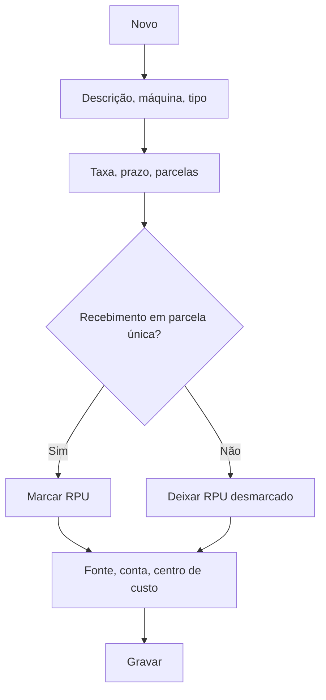

# Cartão (Máquinas/Operadoras)

## Objetivo

Cadastrar as **máquinas/operadoras de cartão** usadas no recebimento — com a taxa (percentual ou
valor fixo), o prazo de crédito, a fonte e a conta associadas. É o que permite conciliar
corretamente os recebimentos em cartão (ver [Entrada de Cartão](../financeiro/entrada-cartao.md)).

---

## Como acessar

```
Tabelas
→ Cartão
```

---

## Quando utilizar

- Ao configurar cada máquina/bandeira/operadora de cartão aceita pela escola.

---

## Como utilizar

1. Abra **Cartão**.
2. Clique em **Novo**.
3. Informe o **Cartão** (descrição), o **Nome da Máquina** e o **Tipo**.
4. Configure a taxa: **Percentual (%)** ou **Valor Fixo (R$)**, os **Dias para Recebimento** e a
   **Máxima de Parcelas**.
5. Se este cartão for de **recebimento em parcelamento único**, marque a caixa
   **RPU (Recebimento de Parcelamento Único)**.
6. Indique a **Fonte**, a **Conta** e o **Centro de Custo** (para preenchimento automático no
   Contas a Pagar).
7. Clique em **Gravar**.

---

## Campos

| Campo | Descrição | Obrigatório | Observações |
|-------|-----------|-------------|-------------|
| Cartão | Descrição do cartão | Sim | |
| Nome da Máquina | Identificação da máquina | Não | |
| Tipo | Tipo do cartão | Não | Crédito/débito |
| Percentual (%) / Valor Fixo (R$) | Taxa da operadora | Não | |
| Dias para Recebimento | Prazo até o crédito | Não | |
| Máxima de Parcelas | Limite de parcelas | Não | |
| RPU (Recebimento de Parcelamento Único) | Marca o cartão como de **parcela única** | Não | Quando marcado, o campo **Parcelas** fica **desabilitado (sempre 1)** nas telas de recebimento |
| Fonte | Fonte de crédito | Não | |
| Conta | Conta contábil | Não | |
| Centro de Custo | Centro de custo para o Contas a Pagar | Não | Preenchimento automático |

---

## Botões

| Botão | O que faz |
|-------|-----------|
| **Novo** | Cadastra um novo cartão/máquina |
| **Pesquisar** | Busca cartões |
| **Gravar** | Salva o registro |
| **Opções** | Editar/excluir |

---

## Resultados

- O cartão fica disponível como forma de recebimento e para a conciliação de crédito.
- Nas telas de recebimento, o cartão aparece no dropdown com a taxa, a quantidade de parcelas, os
  dias para recebimento e, quando for o caso, a marcação **RPU** ao final da descrição.

---

## Regras importantes

- A **taxa** e os **dias para recebimento** são usados no cálculo do crédito e da tarifa.
- Um cartão marcado como **RPU** é sempre recebido em **parcela única**: nas telas de
  [Recebimento de Mensalidade](../financeiro/recebimento-mensalidade.md),
  [Ficha Financeira](../financeiro/ficha-financeira.md) e
  [Outros Recebimentos](../financeiro/outros-recebimentos.md), o campo **Parcelas** fica
  desabilitado e fixo em **1**.
- O parcelamento só é oferecido para cartões do tipo **Parcelado** que **não** estejam marcados
  como RPU.

---

## Fluxo da funcionalidade



---

## Exemplos práticos

**Exemplo 1:** cadastrar a máquina "Crédito Visa" com taxa de 3%, crédito em 30 dias, até 12 parcelas.

**Exemplo 2 — cartão RPU:** cadastrar a máquina "Crédito à Vista" com taxa de 2%, crédito em 30
dias e a caixa **RPU** marcada. No recebimento, o operador não conseguirá parcelar essa venda —
o que evita lançamentos indevidos.

---

## Dicas

- Configure a **taxa** corretamente para a [Entrada de Cartão](../financeiro/entrada-cartao.md) refletir o líquido.
- Use o **RPU** nas máquinas em que a escola não aceita parcelamento: é a forma mais segura de
  impedir o erro na hora do recebimento.

---

## FAQ

**Qual a diferença para Cartão Institucional?**
Aqui é o cartão de **recebimento** (máquinas); o [Cartão Institucional](cartao-institucional.md) é
o cartão de **pagamento** da escola.

**O que significa RPU?**
**Recebimento de Parcelamento Único.** É o cartão que só aceita pagamento em uma parcela.

**Marquei RPU e o campo Parcelas sumiu do recebimento. É erro?**
Não. O campo fica desabilitado propositalmente, fixo em 1 parcela.

---

## Prints

- [ ] Lista de cartões.
- [ ] Formulário do cartão com a caixa **RPU**.

---

## Histórico

| Data | Alteração |
|------|-----------|
| 30/07/2026 | Página criada. |
| 21/08/2026 | Novo campo **RPU (Recebimento de Parcelamento Único)**: quando marcado, o campo **Parcelas** fica desabilitado e fixo em 1 nas telas de recebimento, e a marcação **RPU** passa a aparecer na descrição do cartão nos dropdowns. |
