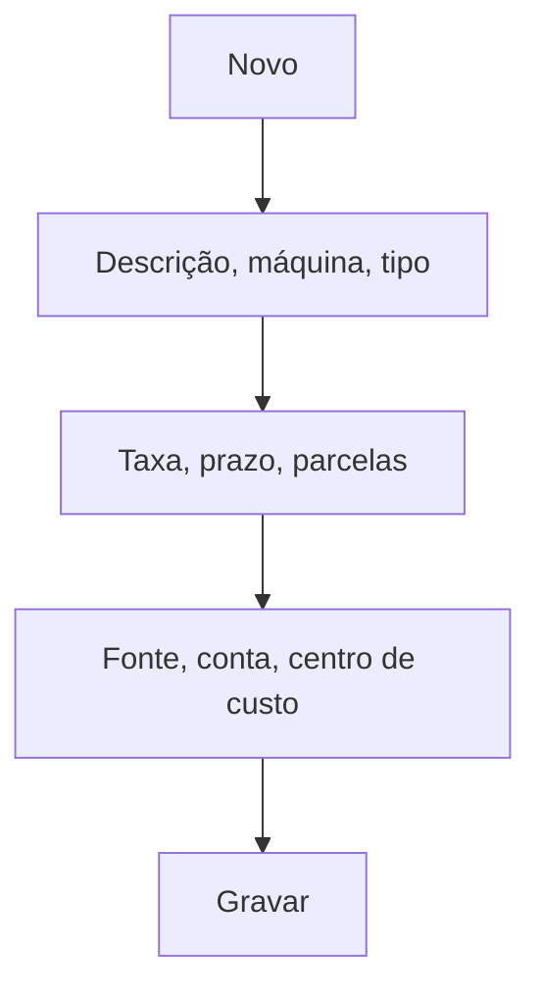

# Cartão (Máquinas/Operadoras)

## Objetivo

Cadastrar as **máquinas/operadoras de cartão** usadas no recebimento — com a taxa (percentual ou
valor fixo), o prazo de crédito, a fonte e a conta associadas. É o que permite conciliar
corretamente os recebimentos em cartão (ver [Entrada de Cartão](../financeiro/entrada-cartao.md)).

---

## Como acessar

```
Tabelas
→ Cartão
```

---

## Quando utilizar

- Ao configurar cada máquina/bandeira/operadora de cartão aceita pela escola.

---

## Como utilizar

1. Abra **Cartão**.
2. Clique em **Novo**.
3. Informe o **Cartão** (descrição), o **Nome da Máquina** e o **Tipo**.
4. Configure a taxa: **Percentual (%)** ou **Valor Fixo (R$)**, os **Dias para Recebimento** e a
   **Máxima de Parcelas**.
5. Indique a **Fonte**, a **Conta** e o **Centro de Custo** (para preenchimento automático no
   Contas a Pagar).
6. Clique em **Gravar**.

---

## Campos

| Campo | Descrição | Obrigatório | Observações |
|-------|-----------|-------------|-------------|
| Cartão | Descrição do cartão | Sim | |
| Nome da Máquina | Identificação da máquina | Não | |
| Tipo | Tipo do cartão | Não | Crédito/débito |
| Percentual (%) / Valor Fixo (R$) | Taxa da operadora | Não | |
| Dias para Recebimento | Prazo até o crédito | Não | |
| Máxima de Parcelas | Limite de parcelas | Não | |
| Fonte | Fonte de crédito | Não | |
| Conta | Conta contábil | Não | |
| Centro de Custo | Centro de custo para o Contas a Pagar | Não | Preenchimento automático |

---

## Botões

| Botão | O que faz |
|-------|-----------|
| **Novo** | Cadastra um novo cartão/máquina |
| **Pesquisar** | Busca cartões |
| **Gravar** | Salva o registro |
| **Opções** | Editar/excluir |

---

## Resultados

- O cartão fica disponível como forma de recebimento e para a conciliação de crédito.

---

## Regras importantes

- A **taxa** e os **dias para recebimento** são usados no cálculo do crédito e da tarifa.

---

## Fluxo da funcionalidade



---

## Exemplos práticos

**Exemplo:** cadastrar a máquina "Crédito Visa" com taxa de 3%, crédito em 30 dias, até 12 parcelas.

---

## Dicas

- Configure a **taxa** corretamente para a [Entrada de Cartão](../financeiro/entrada-cartao.md) refletir o líquido.

---

## FAQ

**Qual a diferença para Cartão Institucional?**
Aqui é o cartão de **recebimento** (máquinas); o [Cartão Institucional](cartao-institucional.md) é
o cartão de **pagamento** da escola.

---

## Prints

- [ ] Lista de cartões.
- [ ] Formulário do cartão.

---

## Histórico

| Data | Alteração |
|------|-----------|
| 30/07/2026 | Página criada. |
