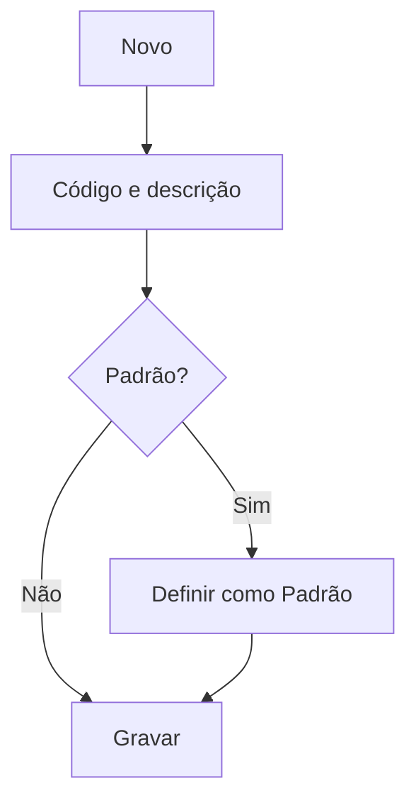

# Centro de Custo

## Objetivo

Cadastrar os **centros de custo** — as categorias que agrupam as **despesas** da escola
(Administrativo, Pedagógico, Manutenção, etc.). São usados no [Contas a Pagar](../financeiro/contas-a-pagar.md)
para organizar os gastos e alimentar relatórios gerenciais.

---

## Quem pode utilizar

Financeiro e Administrador.

---

## Como acessar

```
Tabelas
→ Centro de Custo
```

---

## Quando utilizar

- Ao estruturar as categorias de despesa da escola.

---

## Como utilizar

1. Abra **Centro de Custo**.
2. Clique em **Novo**.
3. Informe o **Código** e a **Descrição**.
4. Marque **Definir como Padrão** se este for o centro de custo sugerido por padrão.
5. Clique em **Gravar**.

---

## Campos

| Campo | Descrição | Obrigatório |
|-------|-----------|-------------|
| Código | Código do centro de custo | Sim |
| Descrição | Nome do centro de custo | Sim |
| Definir como Padrão | Torna-o o padrão nas despesas | Não |

---

## Botões

| Botão | O que faz |
|-------|-----------|
| **Novo** | Cadastra um novo centro de custo |
| **Pesquisar** | Busca centros de custo |
| **Gravar** | Salva o registro |
| **Opções** | Editar/excluir |

---

## Resultados

- O centro de custo fica disponível no Contas a Pagar e nos relatórios de despesa.

---

## Regras importantes

- Apenas um centro de custo pode ser o **padrão**.
- **Código** e **Descrição** são obrigatórios.

---

## Fluxo da funcionalidade



---

## Exemplos práticos

**Exemplo:** cadastrar "Administrativo", "Pedagógico" e "Manutenção" como centros de custo.

---

## Dicas

- Defina um centro de custo **padrão** para agilizar o lançamento de despesas.

---

## FAQ

**Onde uso o centro de custo?**
No [Contas a Pagar](../financeiro/contas-a-pagar.md), ao registrar cada despesa.

---

## Prints

- [ ] Lista de centros de custo.
- [ ] Formulário.

---

## Histórico

| Data | Alteração |
|------|-----------|
| 30/07/2026 | Página criada. |
