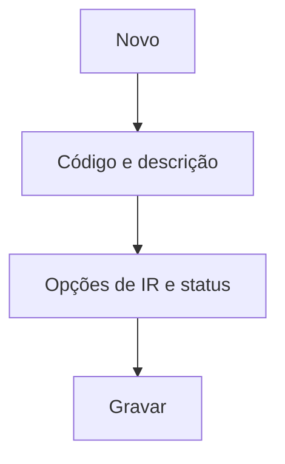

# Convênio

## Objetivo

Cadastrar os **convênios** de desconto — acordos que concedem abatimento nas mensalidades (ex.:
convênio com empresas, descontos para funcionários, irmãos). O convênio é aplicado na matrícula
e pode ter tratamento específico para imposto de renda.

---

## Quem pode utilizar

Financeiro e Administrador.

---

## Como acessar

```
Tabelas
→ Convênio
```

---

## Quando utilizar

- Ao firmar um convênio de desconto que será aplicado a alunos.

---

## Como utilizar

1. Abra **Convênio**.
2. Clique em **Novo**.
3. Informe o **Código** e a **Descrição**.
4. Marque as opções aplicáveis: se é o convênio padrão, **Não contabilizar para Imposto de Renda**
   e **Desabilitar esse código** quando não estiver mais em uso.
5. Clique em **Gravar**.

---

## Campos

| Campo | Descrição | Obrigatório | Observações |
|-------|-----------|-------------|-------------|
| Código | Código do convênio | Sim | |
| Descrição | Nome do convênio | Sim | |
| Não contabilizar para Imposto de Renda | Exclui da declaração de IR | Não | |
| Desabilitar esse código | Inativa o convênio | Não | |

---

## Botões

| Botão | O que faz |
|-------|-----------|
| **Novo** | Cadastra um novo convênio |
| **Pesquisar** | Busca convênios |
| **Gravar** | Salva o convênio |
| **Opções** | Editar/desabilitar |

---

## Resultados

- O convênio fica disponível para ser aplicado na matrícula/plano de pagamento.

---

## Regras importantes

- **Código** e **Descrição** são obrigatórios.
- A opção de **não contabilizar para IR** afeta a declaração emitida ao responsável.

---

## Fluxo da funcionalidade



---

## Exemplos práticos

**Exemplo:** cadastrar o convênio "Desconto Irmãos" aplicado a alunos com irmãos matriculados.

---

## Dicas

- Desabilite convênios antigos em vez de excluí-los, preservando o histórico.

---

## FAQ

**Onde o desconto do convênio é aplicado?**
Na matrícula do aluno e no plano de pagamento vinculado.

---

## Prints

- [ ] Lista de convênios.
- [ ] Formulário do convênio.

---

## Histórico

| Data | Alteração |
|------|-----------|
| 30/07/2026 | Página criada. |
