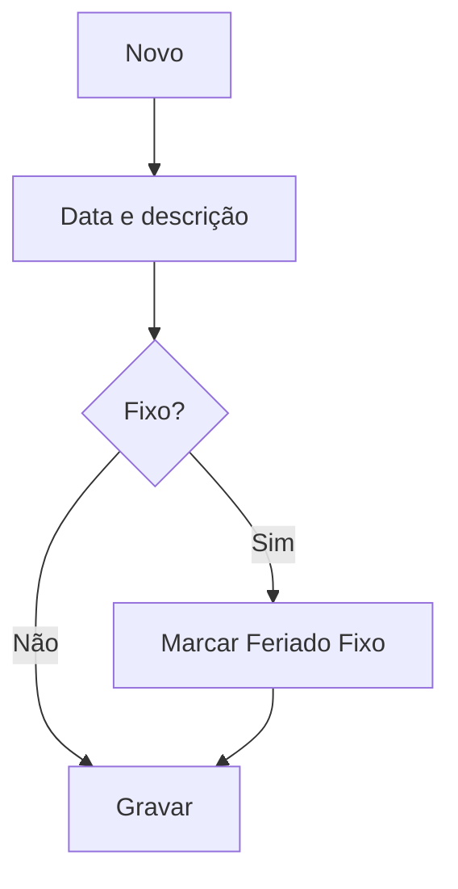

# Feriado Financeiro

## Objetivo

Cadastrar os **feriados** que afetam o financeiro — datas em que não há expediente bancário, para
que os **vencimentos** e cálculos considerem esses dias. Suporta feriados fixos (sempre na mesma
data) e móveis.

---

## Como acessar

```
Tabelas
→ Feriado Financeiro
```

---

## Quando utilizar

- Ao configurar o calendário de feriados que impacta vencimentos e boletos.

---

## Como utilizar

1. Abra **Feriado Financeiro**.
2. Clique em **Novo**.
3. Informe a **Data** e a **Descrição** do feriado.
4. Marque **Feriado Fixo (sempre na mesma data)** quando ele se repete todo ano na mesma data.
5. Clique em **Gravar**.

---

## Campos

| Campo | Descrição | Obrigatório |
|-------|-----------|-------------|
| Data | Data do feriado | Sim |
| Descrição | Nome do feriado | Sim |
| Feriado Fixo (sempre na mesma data) | Repete todo ano na mesma data | Não |

---

## Botões

| Botão | O que faz |
|-------|-----------|
| **Novo** | Cadastra um novo feriado |
| **Pesquisar** | Busca feriados |
| **Gravar** | Salva o registro |
| **Opções** | Editar/excluir |

---

## Resultados

- Os feriados passam a ser considerados nos vencimentos e cálculos financeiros.

---

## Regras importantes

- **Data** e **Descrição** são obrigatórias.
- **Feriado Fixo** dispensa recadastrar a cada ano.

---

## Fluxo da funcionalidade



---

## Exemplos práticos

**Exemplo:** cadastrar "Natal" (25/12) como feriado fixo.

---

## Dicas

- Mantenha os feriados móveis (ex.: Carnaval) atualizados a cada ano.

---

## FAQ

**Isso muda a data de vencimento dos boletos?**
Ajuda o sistema a tratar vencimentos que caem em dias não úteis conforme a configuração.

---

## Prints

- [ ] Lista de feriados.
- [ ] Formulário.

---

## Histórico

| Data | Alteração |
|------|-----------|
| 30/07/2026 | Página criada. |
