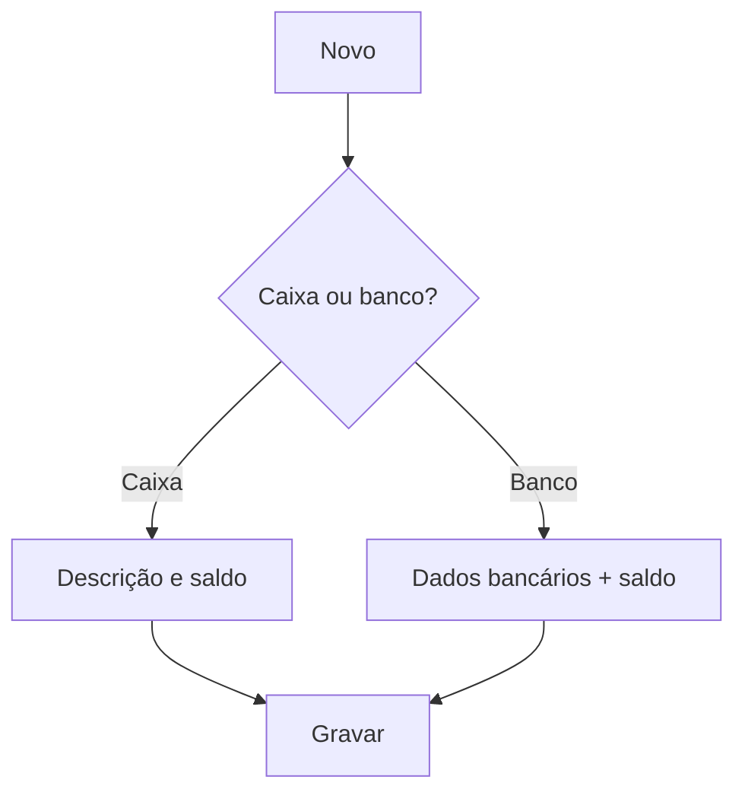

# Fonte Financeira

## Objetivo

Cadastrar as **fontes financeiras** — os lugares por onde o dinheiro entra e sai: o **caixa
geral** e as **contas bancárias**. Toda movimentação (recebimento, pagamento, transferência) é
vinculada a uma fonte, e cada fonte tem seu **saldo**.

---

## Quem pode utilizar

Financeiro e Administrador.

---

## Como acessar

```
Tabelas
→ Fonte Financeira
```

---

## Quando utilizar

- Ao cadastrar o caixa e as contas bancárias da escola.

---

## Como utilizar

1. Abra **Fonte Financeira**.
2. Clique em **Novo**.
3. Informe a **Fonte Financeira** (descrição) e o tipo: marque **Essa fonte é Caixa Geral** ou
   **Essa fonte é BANCO**.
4. Para banco, informe **Código do Banco**, **Agência** e **Conta Corrente**.
5. Informe o **Saldo (R$)** inicial e a **Data do Saldo**.
6. Clique em **Gravar**.

---

## Campos

| Campo | Descrição | Obrigatório | Observações |
|-------|-----------|-------------|-------------|
| Fonte Financeira | Nome da fonte | Sim | |
| Essa fonte é Caixa Geral | Marca como caixa | Condicional | Caixa ou banco |
| Essa fonte é BANCO | Marca como banco | Condicional | |
| Código do Banco / Agência / Conta Corrente | Dados bancários | Condicional | Para fontes banco |
| Saldo R$ | Saldo inicial | Não | |
| Data do Saldo | Data do saldo inicial | Não | |
| Desabilitar esse código | Inativa a fonte | Não | |

---

## Botões

| Botão | O que faz |
|-------|-----------|
| **Novo** | Cadastra uma nova fonte |
| **Pesquisar** | Busca fontes |
| **Gravar** | Salva a fonte |
| **Opções** | Editar/desabilitar |

---

## Resultados

- A fonte fica disponível para recebimentos, pagamentos e transferências.

---

## Regras importantes

- Cada fonte é **caixa** ou **banco**; fontes banco exigem dados bancários.
- O **saldo** da fonte é movimentado pelas operações financeiras.
- Fontes em uso podem ser **desabilitadas** em vez de excluídas.

---

## Fluxo da funcionalidade



---

## Exemplos práticos

**Exemplo:** cadastrar "Caixa Geral" e a conta "Banco X — Ag 1234 / CC 5678".

---

## Dicas

- Defina o **saldo inicial** correto com a data certa para os controles baterem desde o início.

---

## FAQ

**Posso excluir uma fonte já usada?**
Prefira **desabilitar** — a exclusão pode ser impedida por lançamentos vinculados.

---

## Prints

- [ ] Lista de fontes.
- [ ] Formulário (caixa e banco).

---

## Histórico

| Data | Alteração |
|------|-----------|
| 30/07/2026 | Página criada. |
