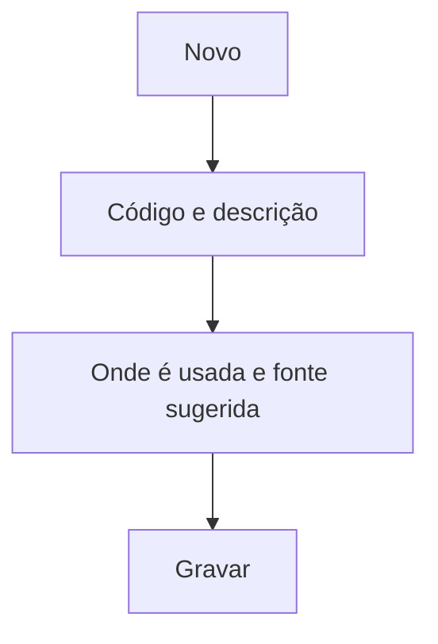

# Forma de Recebimento

## Objetivo

Cadastrar as **formas de recebimento/pagamento** (dinheiro, cartão, PIX, cheque, boleto,
transferência, etc.) que aparecem nas telas financeiras. Cada forma pode sugerir uma **fonte** e
indicar em quais operações ela é usada.

---

## Como acessar

```
Tabelas
→ Forma de Recebimento
```

---

## Quando utilizar

- Ao definir os meios de pagamento aceitos pela escola.

---

## Como utilizar

1. Abra **Forma de Recebimento**.
2. Clique em **Novo**.
3. Informe o **Código** e a **Descrição** (ex.: "PIX").
4. Defina o **Tipo de Recebimento/Pagamento** e onde a forma é usada:
   **Recebimento de Mensalidades**, **Outros Recebimentos**, **A Pagar**.
5. Indique a **Fonte Sugerida** e se ela é **obrigatória**.
6. Clique em **Gravar**.

---

## Campos

| Campo | Descrição | Obrigatório | Observações |
|-------|-----------|-------------|-------------|
| Código | Código da forma | Sim | |
| Descrição | Nome da forma | Sim | |
| Tipo de Recebimento/Pagamento | Natureza da forma | Sim | |
| Recebimento de Mensalidades / Outros Recebimentos / A Pagar | Onde a forma é usada | Não | |
| Fonte Sugerida | Fonte padrão associada | Não | |
| Fonte Sugerida Obrigatória | Torna a fonte obrigatória | Não | |
| Desabilitar esse código | Inativa a forma | Não | |

---

## Botões

| Botão | O que faz |
|-------|-----------|
| **Novo** | Cadastra uma nova forma |
| **Pesquisar** | Busca formas |
| **Gravar** | Salva a forma |
| **Opções** | Editar/desabilitar |

---

## Resultados

- A forma passa a aparecer nas telas de recebimento/pagamento correspondentes.

---

## Regras importantes

- **Código**, **Descrição** e **Tipo** são obrigatórios.
- A **Fonte Sugerida** agiliza o lançamento e pode ser tornada obrigatória.

---

## Fluxo da funcionalidade



---

## Exemplos práticos

**Exemplo:** cadastrar "PIX" com fonte sugerida "Banco X", habilitada para recebimento de mensalidades.

---

## Dicas

- Configure a **fonte sugerida** para reduzir erros no lançamento diário.

---

## FAQ

**Por que uma forma não aparece no recebimento?**
Verifique se ela está marcada para **Recebimento de Mensalidades / Outros Recebimentos**.

---

## Prints

- [ ] Lista de formas.
- [ ] Formulário da forma.

---

## Histórico

| Data | Alteração |
|------|-----------|
| 30/07/2026 | Página criada. |
