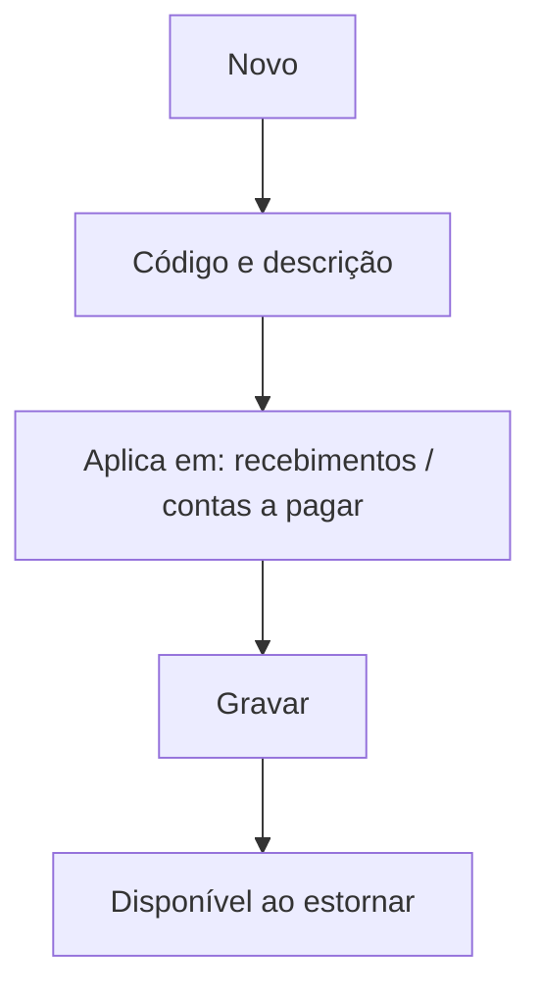

# Ocorrência de Estorno

## Objetivo

Cadastrar os **motivos de estorno** padronizados — as razões que o operador seleciona ao estornar
um recebimento ou pagamento (ex.: "erro de digitação", "cheque devolvido", "cancelamento"). Padroniza
e permite auditar os estornos.

---

## Quem pode utilizar

Financeiro e Administrador.

---

## Como acessar

```
Tabelas
→ Ocorrência de Estorno
```

---

## Quando utilizar

- Ao definir a lista de motivos de estorno usados nas telas financeiras.

---

## Como utilizar

1. Abra **Ocorrência de Estorno**.
2. Clique em **Novo**.
3. Informe o **Código da Ocorrência** e a **Descrição**.
4. Indique onde a ocorrência se aplica: **Recebimentos** e/ou **Contas A Pagar**.
5. Marque **Desabilitar essa ocorrência** quando não for mais usada.
6. Clique em **Gravar**.

---

## Campos

| Campo | Descrição | Obrigatório |
|-------|-----------|-------------|
| Código da Ocorrência | Código do motivo | Sim |
| Descrição | Texto do motivo | Sim |
| Recebimentos | Aplica-se a estornos de recebimento | Não |
| Contas A Pagar | Aplica-se a estornos de pagamento | Não |
| Desabilitar essa ocorrência | Inativa o motivo | Não |

---

## Botões

| Botão | O que faz |
|-------|-----------|
| **Novo** | Cadastra um novo motivo |
| **Pesquisar** | Busca motivos |
| **Gravar** | Salva o registro |
| **Opções** | Editar/desabilitar |

---

## Resultados

- Os motivos ficam disponíveis para seleção ao estornar recebimentos/pagamentos.

---

## Regras importantes

- **Código** e **Descrição** são obrigatórios.
- Ao estornar, o sistema pode exigir a seleção de um motivo (*"Insira o código de estorno"*).

---

## Fluxo da funcionalidade



---

## Exemplos práticos

**Exemplo:** cadastrar "Cheque devolvido" como motivo aplicável a recebimentos.

---

## Dicas

- Padronize os motivos para facilitar relatórios e auditoria de estornos.

---

## FAQ

**Onde escolho o motivo?**
Ao confirmar um estorno nas telas de recebimento/pagamento.

---

## Prints

- [ ] Lista de ocorrências.
- [ ] Formulário.

---

## Histórico

| Data | Alteração |
|------|-----------|
| 30/07/2026 | Página criada. |
