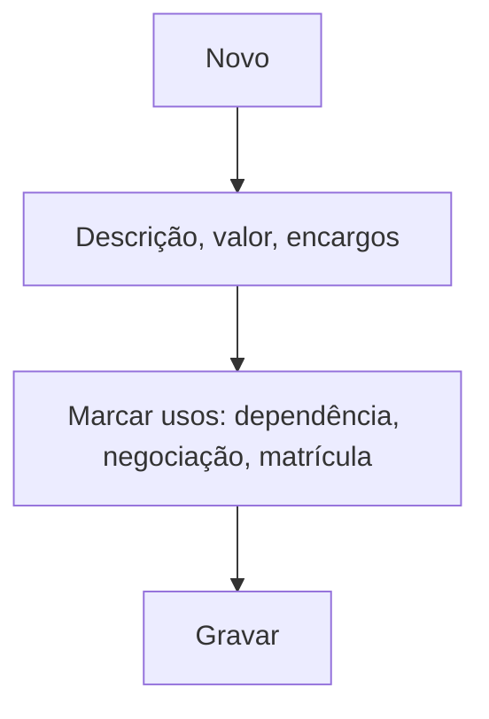

# Parcela Extra

## Objetivo

Cadastrar **parcelas extras** — cobranças avulsas além da mensalidade, usadas em situações como
**negociação de débito**, **dependência**, taxas específicas ou parcelamento de matrícula.
Definem valor, encargos e como se comportam na ficha financeira.

---

## Como acessar

```
Tabelas
→ Parcela Extra
```

---

## Quando utilizar

- Ao criar um tipo de cobrança avulsa reutilizável (negociação, dependência, taxa).

---

## Como utilizar

1. Abra **Parcela Extra**.
2. Clique em **Novo** (ou **Novo Com Base Nesse**).
3. Informe a **Parcela** (descrição), o **Valor**, o **Desconto**, os **Juros** e a **Multa**.
4. Marque os comportamentos aplicáveis: pode ser usada para **DEPENDÊNCIA**, para **NEGOCIAÇÃO de
   débito**, **Gerar registro na Ficha Financeira do aluno**, **Liberar para parcelamento de
   matrícula**, **Contabilizar para IR** e **Utilizar conta padrão do código de pagamento do aluno**.
5. Clique em **Gravar**.

---

## Campos

| Campo | Descrição | Obrigatório | Observações |
|-------|-----------|-------------|-------------|
| Parcela / Descrição | Nome da parcela extra | Sim | |
| Valor | Valor da parcela | Sim | |
| Desconto / Juros / Multa | Encargos | Não | |
| Pode ser usada para DEPENDÊNCIA | Habilita uso em dependência | Não | |
| Pode ser usada para NEGOCIAÇÃO de débito | Habilita uso em negociação | Não | |
| Gerar registro na Ficha Financeira | Cria a parcela na ficha do aluno | Não | |
| Liberar para parcelamento de matrícula | Uso no parcelamento de matrícula | Não | |
| Contabilizar para IR | Entra na declaração de IR | Não | |
| Utilizar conta padrão do código de pagamento | Usa a conta padrão do aluno | Não | Senão, informar conta manualmente |
| Desabilitar Parcela | Inativa a parcela | Não | |

---

## Botões

| Botão | O que faz |
|-------|-----------|
| **Novo** | Cadastra uma nova parcela extra |
| **Novo Com Base Nesse** | Duplica uma parcela existente |
| **Pesquisar** | Busca parcelas extras |
| **Gravar** | Salva o registro |
| **Opções** | Editar/desabilitar |

---

## Filtros e colunas

Colunas: **Descrição**, **Parcela**, **Conta**, **Dep.**, **Neg. Déb.**, **Mat. Par.**, **Ficha**, **IR**, **Status**.

---

## Resultados

- A parcela extra fica disponível para uso em negociações, dependências e cobranças avulsas.

---

## Regras importantes

- Se não usar a **conta padrão**, é preciso informar a conta manualmente.
- Os comportamentos marcados determinam **onde** a parcela pode ser usada.

---

## Fluxo da funcionalidade



---

## Exemplos práticos

**Exemplo:** criar a parcela extra "Taxa de Dependência" habilitada para dependência e com registro na ficha.

---

## Dicas

- Marque **Gerar registro na Ficha Financeira** quando a parcela precisar aparecer para o aluno.

---

## FAQ

**Qual a diferença para o plano de pagamento?**
O [plano](plano-pagamento.md) define as mensalidades; a parcela extra é uma cobrança **avulsa/complementar**.

---

## Prints

- [ ] Lista de parcelas extras.
- [ ] Formulário.

---

## Histórico

| Data | Alteração |
|------|-----------|
| 30/07/2026 | Página criada. |
