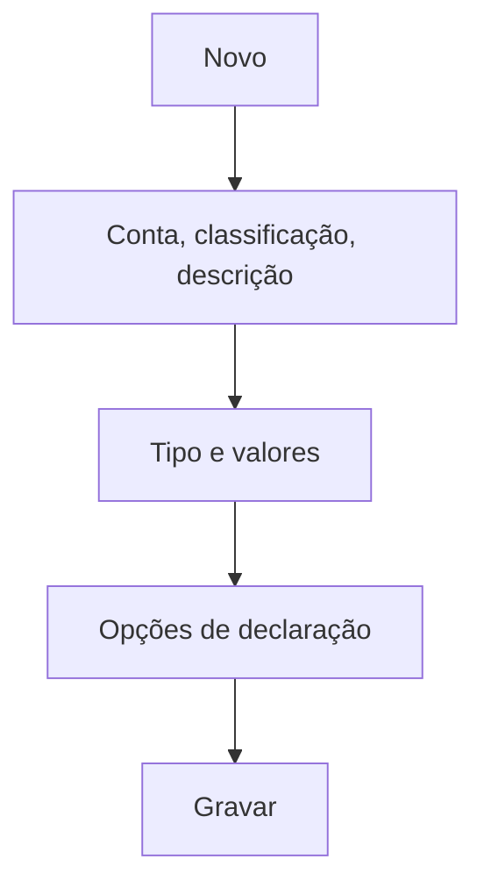

# Plano de Contas

## Objetivo

Cadastrar o **plano de contas** — a estrutura de **contas de receita e despesa** usada para
classificar cada lançamento financeiro (mensalidades, taxas, salários, aluguel, etc.). É a base
dos relatórios financeiros e das declarações.

---

## Como acessar

```
Tabelas
→ Plano de Contas
```

---

## Quando utilizar

- Ao estruturar a contabilidade gerencial da escola.
- Ao criar uma nova conta de receita/despesa.

---

## Como utilizar

1. Abra **Plano de Contas**.
2. Clique em **Novo**.
3. Informe a **Conta**, a **Classificação**, a **Descrição** e a **Descrição Simplificada**.
4. Defina o **Tipo** (receita/despesa) e, se aplicável, **Valor (R$)** / **Percentual (%)**.
5. Marque as opções de declaração: **Contabilizar para Declaração de Imposto de Renda** e/ou
   **de Quitação**, e **Permitir gerar NFSe separado** quando usar o MaisNFSe.
6. Clique em **Gravar**.

---

## Campos

| Campo | Descrição | Obrigatório | Observações |
|-------|-----------|-------------|-------------|
| Conta | Código da conta | Sim | |
| Classificação | Classificação hierárquica | Sim | |
| Descrição | Nome da conta | Sim | |
| Descrição Simplificada | Nome curto | Não | |
| Tipo | Receita ou despesa | Sim | |
| Valor (R$) / Percentual (%) | Valores associados | Não | |
| Contabilizar para IR | Entra na declaração de IR | Não | |
| Contabilizar para Quitação | Entra na declaração de quitação | Não | |
| Permitir gerar NFSe separado | Integração MaisNFSe | Não | |

---

## Botões

| Botão | O que faz |
|-------|-----------|
| **Novo** | Cadastra uma nova conta |
| **Pesquisar** | Busca contas |
| **Gravar** | Salva a conta |
| **Opções** | Editar/alterar classificação |

---

## Resultados

- As contas ficam disponíveis para classificar recebimentos, pagamentos e faturas.

---

## Regras importantes

- **Conta**, **Classificação**, **Descrição** e **Tipo** são essenciais.
- As marcações de **IR/Quitação** afetam as declarações emitidas pela escola.

---

## Fluxo da funcionalidade



---

## Exemplos práticos

**Exemplo:** criar a conta "Receitas > Mensalidades" e "Despesas > Folha de Pagamento".

---

## Dicas

- Estruture a **classificação** com cuidado — é ela que organiza os relatórios financeiros.

---

## FAQ

**A conta aparece onde?**
Nos recebimentos, contas a pagar e nos relatórios financeiros por conta.

---

## Prints

- [ ] Lista/estrutura do plano de contas.
- [ ] Formulário de conta.

---

## Histórico

| Data | Alteração |
|------|-----------|
| 30/07/2026 | Página criada. |
