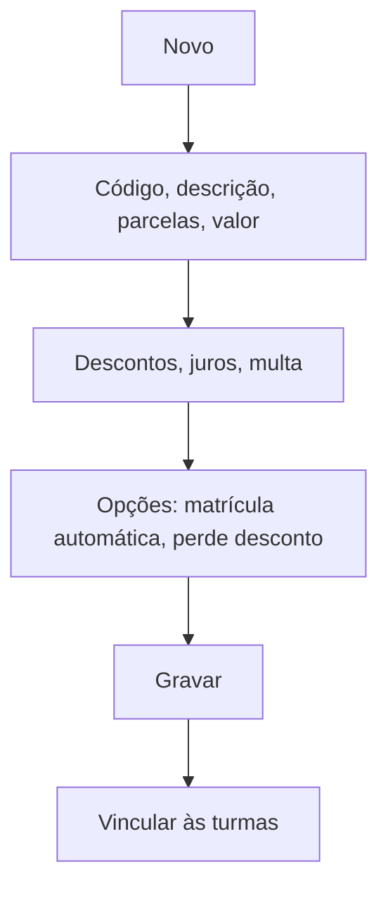

# Plano de Pagamento

## Objetivo

Cadastrar os **planos de pagamento** — as condições de parcelamento das mensalidades (número de
parcelas, valores, descontos, juros/multa por atraso). Os planos são depois vinculados às turmas
em [Plano de Pagamento por Turma](../academico/plano-pagamento-turma.md) e escolhidos na matrícula.

---

## Quem pode utilizar

Financeiro e Administrador.

---

## Como acessar

```
Tabelas
→ Plano de Pagamento
```

---

## Quando utilizar

- Ao definir as condições financeiras oferecidas (ex.: 12x, à vista com desconto).

---

## Como utilizar

1. Abra **Plano de Pagamento**.
2. Clique em **Novo** (ou **Novo Com Base Nesse**).
3. Informe **Código**, **Descrição**, a **Parcela** (quantidade), **Valor** e **Desconto**.
4. Configure **Juros**, **Multa** e **% Desconto**, e o **Convênio Sugerido**.
5. Marque as opções aplicáveis: **Perde desconto após vencimento**, **Este plano realiza
   Matrícula Automática** (passa de Registrado para Matriculado), **Projetar**.
6. Clique em **Gravar**.

---

## Campos

| Campo | Descrição | Obrigatório | Observações |
|-------|-----------|-------------|-------------|
| Código | Código do plano | Sim | |
| Descrição | Nome do plano | Sim | |
| Parcela | Número de parcelas | Sim | |
| Valor | Valor da parcela | Sim | |
| Desconto / % Desconto | Descontos | Não | |
| Juros / Multa | Encargos por atraso | Não | |
| Convênio Sugerido | Convênio associado | Não | |
| Perde desconto após vencimento | Remove o desconto se pago em atraso | Não | |
| Matrícula Automática | Passa Registrado → Matriculado | Não | Ver "Parcela Matrícula Automática" |
| Projetar | Projeta as parcelas | Não | |
| Desabilitar esse código | Inativa o plano | Não | |

---

## Botões

| Botão | O que faz |
|-------|-----------|
| **Novo** | Cadastra um novo plano |
| **Novo Com Base Nesse** | Duplica um plano existente |
| **Pesquisar** | Busca planos |
| **Gravar** | Salva o plano |
| **Opções** | Editar/desabilitar |

---

## Filtros e colunas

Colunas: **Código**, **Descrição**, **Valor 1ª Parcela**, **Desc. 1ª Parcela**, **Desconto**,
**Matríc. Auto**, **Status**.

---

## Resultados

- O plano fica disponível para ser vinculado às turmas e escolhido na matrícula.

---

## Regras importantes

- **Código**, **Descrição**, **Parcela** e **Valor** são essenciais.
- **Perde desconto após vencimento** faz o aluno perder o desconto se pagar atrasado.
- **Matrícula Automática** muda a situação do aluno ao usar o plano.

---

## Fluxo da funcionalidade



---

## Exemplos práticos

**Exemplo:** cadastrar "12x com vencimento dia 10" e "À vista com 10% de desconto".

---

## Dicas

- Use **Novo Com Base Nesse** para criar variações de um plano sem redigitar tudo.

---

## FAQ

**Como o plano chega ao aluno?**
Vinculado à turma em [Plano de Pagamento por Turma](../academico/plano-pagamento-turma.md) e
escolhido na aba Matrícula do [Cadastro de Alunos](../cadastro/alunos.md).

---

## Prints

- [ ] Lista de planos.
- [ ] Formulário do plano.

---

## Histórico

| Data | Alteração |
|------|-----------|
| 30/07/2026 | Página criada. |
