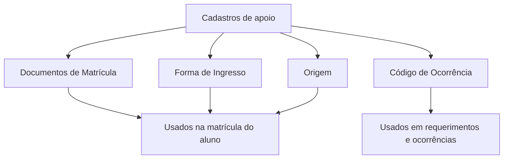

# Módulo Tabelas de Secretaria

## Objetivo

As **Tabelas de Secretaria** são os **cadastros de apoio** usados nos processos da secretaria: os
**códigos de ocorrência/requerimento**, os **documentos exigidos na matrícula**, as **formas de
ingresso** do aluno e as **origens** (como o aluno chegou à escola). Alimentam as demais telas de
matrícula, requerimentos e relatórios.

## Como acessar

As telas ficam no grupo **Tabelas** (Secretaria) do menu lateral.

## Mapa do módulo

| Tela | Para que serve | Documentação |
|------|----------------|--------------|
| Código de Ocorrência | Tipos de ocorrência/requerimento da secretaria | [Abrir](codigo-ocorrencia.md) |
| Documentos de Matrícula | Lista de documentos exigidos na matrícula | [Abrir](documentos-matricula.md) |
| Forma de Ingresso | Como o aluno ingressou na escola | [Abrir](forma-ingresso.md) |
| Origem | Origem do aluno (escola anterior, indicação...) | [Abrir](origem.md) |

## Fluxo geral

---

## Histórico

| Data | Alteração |
|------|-----------|
| 30/07/2026 | Página criada. |
