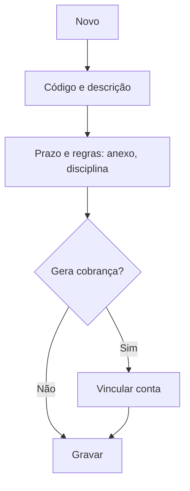

# Código de Ocorrência

## Objetivo

Cadastrar os **tipos de ocorrência/requerimento** da secretaria — as solicitações que os alunos
podem abrir (2ª via de documento, declaração, requerimento de prova, etc.), com prazo de
atendimento e regras (se precisa de anexo, de disciplina, se gera cobrança).

---

## Como acessar

```
Tabelas
→ Código de Ocorrência
```

---

## Quando utilizar

- Ao definir os tipos de requerimento/ocorrência oferecidos pela secretaria.

---

## Como utilizar

1. Abra **Código de Ocorrência**.
2. Clique em **Novo**.
3. Informe o **Código** e a **Descrição**.
4. Defina o **Prazo de Atendimento** e marque se é um **Requerimento**.
5. Marque as regras: **Precisa de anexo**, **Precisa de disciplina**.
6. Se houver cobrança, vincule a **Conta**.
7. Clique em **Gravar**.

---

## Campos

| Campo | Descrição | Obrigatório | Observações |
|-------|-----------|-------------|-------------|
| Código | Código da ocorrência | Sim | |
| Descrição | Nome da ocorrência | Sim | |
| Prazo de Atendimento | Prazo para atender | Não | |
| Requerimento | Marca como requerimento | Não | |
| Precisa de anexo | Exige anexo do solicitante | Não | |
| Precisa de disciplina | Exige indicar disciplina | Não | |
| Conta | Conta de cobrança associada | Não | Quando gera cobrança |

---

## Botões

| Botão | O que faz |
|-------|-----------|
| **Novo** | Cadastra uma nova ocorrência |
| **Pesquisar** | Busca ocorrências |
| **Gravar** | Salva o registro |
| **Opções** | Editar/ativar/desativar |

---

## Filtros e colunas

Colunas: **Código**, **Descrição**, **Ativado**.

---

## Resultados

- A ocorrência fica disponível para abertura de requerimentos e registro de atendimentos.

---

## Regras importantes

- **Código** e **Descrição** são obrigatórios.
- **Precisa de anexo/disciplina** condiciona o preenchimento no momento do requerimento.
- Ocorrências com **Conta** vinculada podem gerar cobrança ao aluno.

---

## Fluxo da funcionalidade



---

## Exemplos práticos

**Exemplo:** cadastrar "2ª via de Histórico" como requerimento, prazo de 5 dias, com cobrança vinculada a uma conta.

---

## Dicas

- Defina o **prazo de atendimento** para acompanhar os requerimentos em aberto.

---

## FAQ

**Onde a ocorrência é usada?**
Na abertura de requerimentos/ocorrências da secretaria e nos relatórios correspondentes.

---

## Prints

- [ ] Lista de códigos de ocorrência.
- [ ] Formulário.

---

## Histórico

| Data | Alteração |
|------|-----------|
| 30/07/2026 | Página criada. |
