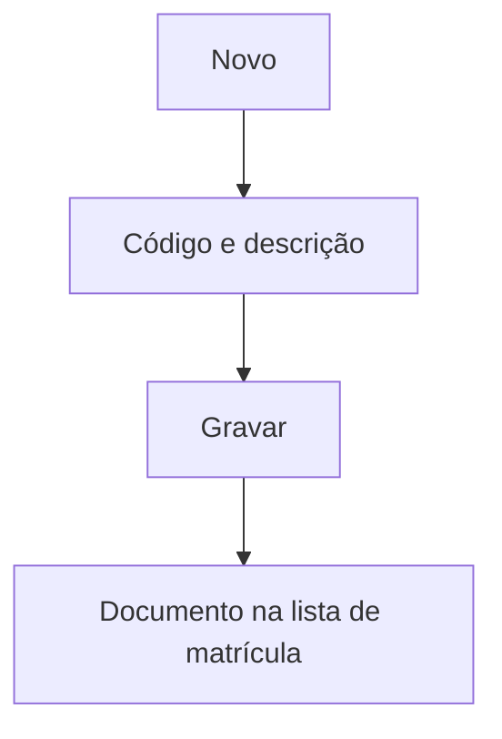

# Documentos de Matrícula

## Objetivo

Cadastrar a **lista de documentos exigidos na matrícula** (RG, CPF, certidão de nascimento,
histórico, comprovante de residência, etc.). Essa lista é usada para conferir e registrar a
entrega dos documentos de cada aluno.

---

## Como acessar

```
Tabelas
→ Documentos de Matrícula
```

---

## Quando utilizar

- Ao definir quais documentos a escola exige na matrícula.

---

## Como utilizar

1. Abra **Documentos de Matrícula**.
2. Clique em **Novo**.
3. Informe o **Código** e a **Descrição** do documento.
4. Clique em **Gravar**.

---

## Campos

| Campo | Descrição | Obrigatório |
|-------|-----------|-------------|
| Código | Código do documento | Sim |
| Descrição | Nome do documento | Sim |

---

## Botões

| Botão | O que faz |
|-------|-----------|
| **Novo** | Cadastra um novo documento |
| **Pesquisar** | Busca documentos |
| **Gravar** | Salva o registro |
| **Opções** | Editar/excluir |

---

## Resultados

- O documento passa a compor a lista de conferência de entrega na matrícula do aluno.

---

## Regras importantes

- **Código** e **Descrição** são obrigatórios.

---

## Fluxo da funcionalidade



---

## Exemplos práticos

**Exemplo:** cadastrar "Certidão de Nascimento", "RG" e "Comprovante de Residência".

---

## Dicas

- Mantenha a lista enxuta com o que é realmente exigido, para agilizar a conferência.

---

## FAQ

**Onde controlo a entrega por aluno?**
No cadastro do aluno (documentos da matrícula), a partir desta lista.

---

## Prints

- [ ] Lista de documentos.
- [ ] Formulário.

---

## Histórico

| Data | Alteração |
|------|-----------|
| 30/07/2026 | Página criada. |
