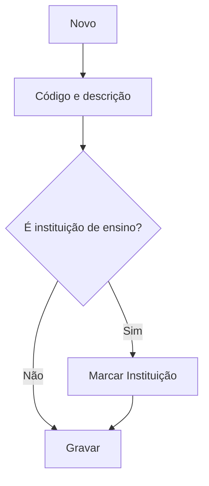

# Origem

## Objetivo

Cadastrar as **origens** do aluno — de onde ele veio (escola anterior, indicação, mudança de
cidade, etc.). Permite indicar quando a origem é uma **Instituição de Ensino**. Serve para o
cadastro do aluno e para análises de captação.

---

## Quem pode utilizar

Secretaria e Administrador.

---

## Como acessar

```
Tabelas
→ Origem
```

---

## Quando utilizar

- Ao definir as origens possíveis dos alunos.

---

## Como utilizar

1. Abra **Origem**.
2. Clique em **Novo**.
3. Informe o **Código** e a **Descrição**.
4. Marque se **Essa forma de origem é uma Instituição de Ensino** (ou **Outro**).
5. Clique em **Gravar**.

---

## Campos

| Campo | Descrição | Obrigatório | Observações |
|-------|-----------|-------------|-------------|
| Código | Código da origem | Sim | |
| Descrição | Nome da origem | Sim | |
| Instituição de Ensino / Outro | Tipo da origem | Não | Marca se é escola de origem |

---

## Botões

| Botão | O que faz |
|-------|-----------|
| **Novo** | Cadastra uma nova origem |
| **Pesquisar** | Busca origens |
| **Gravar** | Salva o registro |
| **Opções** | Editar/excluir |

---

## Resultados

- A origem fica disponível para seleção no cadastro/matrícula do aluno.

---

## Regras importantes

- **Código** e **Descrição** são obrigatórios.
- Marcar **Instituição de Ensino** ajuda a tratar transferências de outras escolas.

---

## Fluxo da funcionalidade



---

## Exemplos práticos

**Exemplo:** cadastrar "Escola Municipal X" (instituição de ensino) e "Indicação" (outro).

---

## Dicas

- Use origens do tipo **Instituição de Ensino** para alunos transferidos, facilitando o histórico.

---

## FAQ

**Qual a diferença para Forma de Ingresso?**
A **origem** é de onde o aluno veio; a [forma de ingresso](forma-ingresso.md) é **como** ele entrou.

---

## Prints

- [ ] Lista de origens.
- [ ] Formulário.

---

## Histórico

| Data | Alteração |
|------|-----------|
| 30/07/2026 | Página criada. |
